# RCWA Benchmark Report

Profile **quick** · **91 excitation points** · **16 cases** · s and p incidence at each point. [Numerical dataset](results/benchmark.json) · [Periodic-case diagnosis](PERIODIC_DIAGNOSIS.md) · [Conclusion](#conclusion)

## Case overview

| Case | Optical problem | Points | Coverage | Max Δpower | Max \|Δamplitude\| | Status |
| --- | --- | --- | --- | --- | --- | --- |
| [A01](#a01) | Fresnel interface | 14 | 4/4 | 9.63e-14 | 1.59e-13 | PASS |
| [A02](#a02) | Antireflection film | 5 | 4/4 | 1.52e-14 | 8.49e-15 | PASS |
| [A03](#a03) | DBR mirror | 5 | 4/4 | 2.55e-13 | 1.38e-13 | PASS |
| [A04](#a04) | Absorbing metal film | 3 | 4/4 | 1.78e-15 | 5.25e-15 | PASS |
| [B01](#b01) | Binary dielectric grating | 4 | 4/4 | 0.00818 | 0.0263 | INCONCLUSIVE |
| [B02](#b02) | High-contrast grating | 5 | 4/4 | 0.116 | 0.147 | INCONCLUSIVE |
| [B03](#b03) | Conical incidence | 5 | 4/4 | 0.00628 | 0.0177 | INCONCLUSIVE |
| [B04](#b04) | Trapezoidal grating | 4 | 4/4 | 0.00579 | 0.0188 | INCONCLUSIVE |
| [B05](#b05) | Wire-grid polarizer | 3 | 4/4 | 0.268 | 0.203 | INCONCLUSIVE |
| [B06](#b06) | Volume index grating | 7 | 4/4 | 0.00017 | 0.0196 | INCONCLUSIVE |
| [C01](#c01) | Metal nanohole array | 5 | 4/4 | 0.141 | 0.117 | INCONCLUSIVE |
| [C02](#c02) | Photonic crystal slab | 5 | 4/4 | 0.991 | 1.02 | INCONCLUSIVE |
| [C03](#c03) | Cylindrical meta-atom | 5 | 4/4 | 0.0188 | 0.266 | INCONCLUSIVE |
| [C04](#c04) | Rotated nanofin | 5 | 4/4 | 0.148 | 0.468 | INCONCLUSIVE |
| [C05](#c05) | Shifted bilayer | 12 | 4/4 | 0.0208 | 0.123 | INCONCLUSIVE |
| [C06](#c06) | Metagrating supercell | 4 | 4/4 | 0.664 | 1.21 | INCONCLUSIVE |

Power differences include total reflectance, transmittance, absorptance, and the efficiency of each propagating diffraction order. Amplitudes use the common power-normalized reference. A missing phase metric means that no matched channel exceeds the reporting floor.

## Solver-pair overview

| Solver pair | Cases | Worst Δpower | Worst \|Δamplitude\| | Cases with both deltas ≤ 1e-3 |
| --- | --- | --- | --- | --- |
| meent / torcwa | 16 | 0.991 | 1.21 | 5 |
| meent / grcwa | 16 | 0.991 | 1.21 | 5 |
| meent / lumerical | 16 | 0.962 | 1.11 | 4 |
| torcwa / grcwa | 16 | 1.05e-12 | 1.08e-11 | 16 |
| torcwa / lumerical | 16 | 0.459 | 0.824 | 4 |
| grcwa / lumerical | 16 | 0.459 | 0.824 | 4 |

The last column counts cases for which both reported maximum differences are at most 1e-3. These counts summarize the sampled data. A periodic case still requires convergence evidence to pass.

## Software versions

| Software or runtime | Version or device |
| --- | --- |
| Python | 3.11.8 |
| rcwa-cross-validation | 0.2.0 |
| numpy | 2.4.6 |
| scipy | 1.17.1 |
| matplotlib | 3.10.8 |
| PyYAML | 6.0.3 |
| threadpoolctl | 3.8.0 |
| meent | 0.13.2 |
| grcwa | 0.1.2 |
| torcwa | 0.1.4.2 |
| torch | 2.8.0+cu128 |
| jupyterlab | 4.6.6 |
| ipykernel | 7.4.0 |
| Lumerical RCWA | v252 / build 8.34.4175 |
| PyTorch CUDA runtime | 12.8 |
| torcwa device | NVIDIA GeForce RTX 4060 Laptop GPU |
| Operating system | Windows-10-10.0.22621-SP0 |

## Case comparisons and figures

### A01

**Fresnel interface**

[Notebook, physical model and applications](cases/A/A01/A01.ipynb)

| Solver pair | Matched points | Max ΔR | Max ΔT | Max ΔA | Max order ΔP | Max \|Δamplitude\| | Max phase Δ (deg) | Worst amplitude point | Status |
| --- | --- | --- | --- | --- | --- | --- | --- | --- | --- |
| reference / meent | 14/14 | 2.66e-15 | 1.44e-15 | 2.66e-15 | 2.66e-15 | 1.34e-15 | 2.74e-14 | 13 | PASS |
| reference / torcwa | 14/14 | 4.44e-16 | 9.99e-16 | 7.77e-16 | 9.99e-16 | 1.85e-15 | 1.06e-13 | 10 | PASS |
| reference / grcwa | 14/14 | 9.71e-16 | 3.55e-15 | 2.66e-15 | 3.55e-15 | 2e-15 | 8.52e-14 | 6 | PASS |
| reference / lumerical | 14/14 | 9.63e-14 | 9.59e-14 | 3.61e-14 | 9.63e-14 | 1.59e-13 | 1.24e-11 | 6 | PASS |
| meent / torcwa | 14/14 | 2.44e-15 | 8.88e-16 | 2.44e-15 | 2.44e-15 | 1.94e-15 | 1.12e-13 | 10 | PASS |
| meent / grcwa | 14/14 | 2.44e-15 | 3.33e-15 | 2.66e-15 | 3.33e-15 | 1.78e-15 | 6.01e-14 | 6 | PASS |
| meent / lumerical | 14/14 | 9.59e-14 | 9.59e-14 | 3.87e-14 | 9.59e-14 | 1.59e-13 | 1.24e-11 | 6 | PASS |
| torcwa / grcwa | 14/14 | 9.71e-16 | 3.55e-15 | 2.66e-15 | 3.55e-15 | 2e-15 | 8.23e-14 | 6 | PASS |
| torcwa / lumerical | 14/14 | 9.6e-14 | 9.59e-14 | 3.63e-14 | 9.6e-14 | 1.59e-13 | 1.24e-11 | 6 | PASS |
| grcwa / lumerical | 14/14 | 9.63e-14 | 9.59e-14 | 3.63e-14 | 9.63e-14 | 1.59e-13 | 1.24e-11 | 6 | PASS |

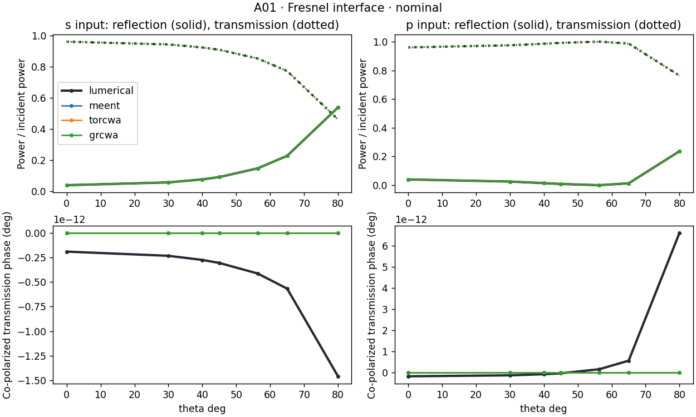

Geometry, additional spectra, diffraction orders and solver differences

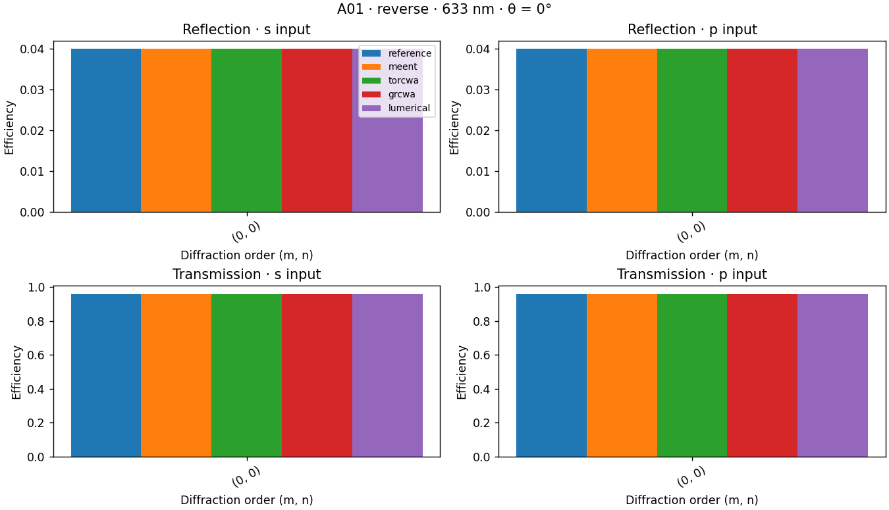

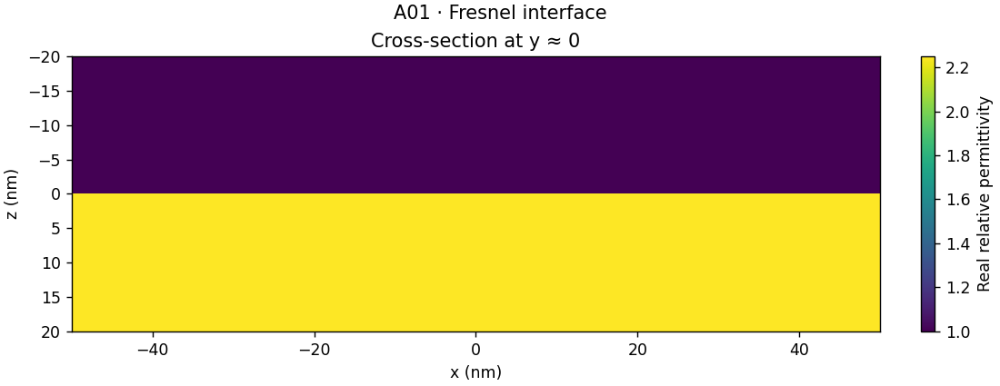

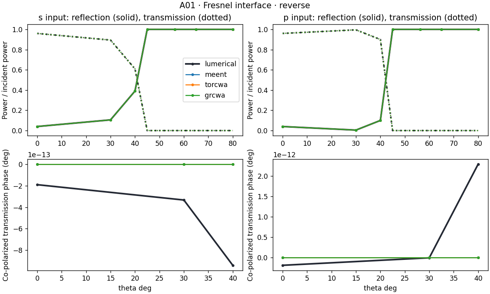

### A02

**Antireflection film**

[Notebook, physical model and applications](cases/A/A02/A02.ipynb)

| Solver pair | Matched points | Max ΔR | Max ΔT | Max ΔA | Max order ΔP | Max \|Δamplitude\| | Max phase Δ (deg) | Worst amplitude point | Status |
| --- | --- | --- | --- | --- | --- | --- | --- | --- | --- |
| reference / meent | 5/5 | 1.04e-17 | 5.55e-16 | 5.55e-16 | 5.55e-16 | 4.57e-16 | 5.35e-13 | 3 | PASS |
| reference / torcwa | 5/5 | 1.56e-17 | 4.44e-16 | 5.55e-16 | 4.44e-16 | 3.51e-16 | 2.41e-13 | 4 | PASS |
| reference / grcwa | 5/5 | 4.16e-17 | 8.88e-16 | 8.88e-16 | 8.88e-16 | 5.66e-16 | 3.04e-13 | 0 | PASS |
| reference / lumerical | 5/5 | 6.02e-16 | 1.38e-14 | 1.43e-14 | 1.38e-14 | 7.94e-15 | 1.85e-12 | 0 | PASS |
| meent / torcwa | 5/5 | 1.91e-17 | 5.55e-16 | 6.66e-16 | 5.55e-16 | 3.89e-16 | 4.44e-13 | 3 | PASS |
| meent / grcwa | 5/5 | 4.51e-17 | 1.22e-15 | 1.22e-15 | 1.22e-15 | 6.75e-16 | 5.17e-13 | 0 | PASS |
| meent / lumerical | 5/5 | 6.12e-16 | 1.41e-14 | 1.47e-14 | 1.41e-14 | 7.9e-15 | 2.16e-12 | 0 | PASS |
| torcwa / grcwa | 5/5 | 2.6e-17 | 6.66e-16 | 7.77e-16 | 6.66e-16 | 5.66e-16 | 1.89e-13 | 0 | PASS |
| torcwa / lumerical | 5/5 | 6.14e-16 | 1.42e-14 | 1.48e-14 | 1.42e-14 | 8.05e-15 | 1.72e-12 | 0 | PASS |
| grcwa / lumerical | 5/5 | 6.4e-16 | 1.47e-14 | 1.52e-14 | 1.47e-14 | 8.49e-15 | 1.65e-12 | 0 | PASS |

Geometry, additional spectra, diffraction orders and solver differences

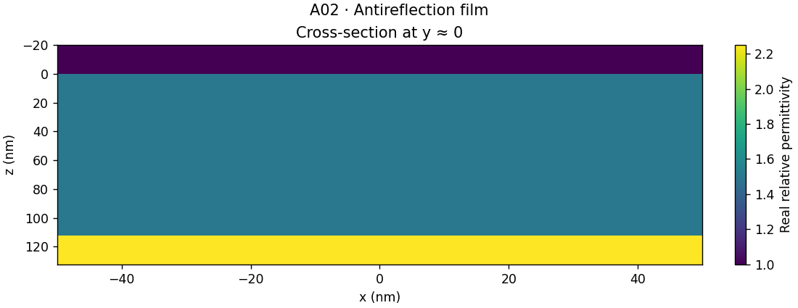

### A03

**DBR mirror**

[Notebook, physical model and applications](cases/A/A03/A03.ipynb)

| Solver pair | Matched points | Max ΔR | Max ΔT | Max ΔA | Max order ΔP | Max \|Δamplitude\| | Max phase Δ (deg) | Worst amplitude point | Status |
| --- | --- | --- | --- | --- | --- | --- | --- | --- | --- |
| reference / meent | 5/5 | 1.08e-15 | 3e-15 | 2.89e-15 | 3e-15 | 3.73e-15 | 2.13e-13 | 1 | PASS |
| reference / torcwa | 5/5 | 8.88e-16 | 2.33e-15 | 3e-15 | 2.33e-15 | 3.41e-15 | 4.03e-13 | 1 | PASS |
| reference / grcwa | 5/5 | 1.12e-15 | 2.78e-15 | 3.55e-15 | 2.78e-15 | 4.27e-15 | 4.82e-13 | 0 | PASS |
| reference / lumerical | 5/5 | 2.05e-14 | 2.53e-13 | 2.54e-13 | 2.53e-13 | 1.38e-13 | 1.96e-11 | 1 | PASS |
| meent / torcwa | 5/5 | 7.22e-16 | 4.55e-15 | 4.11e-15 | 4.55e-15 | 2.49e-15 | 2.81e-13 | 1 | PASS |
| meent / grcwa | 5/5 | 1.29e-15 | 5.33e-15 | 6e-15 | 5.33e-15 | 4.48e-15 | 3.6e-13 | 0 | PASS |
| meent / lumerical | 5/5 | 2.06e-14 | 2.55e-13 | 2.55e-13 | 2.55e-13 | 1.38e-13 | 1.95e-11 | 1 | PASS |
| torcwa / grcwa | 5/5 | 1.28e-15 | 4.44e-15 | 5.66e-15 | 4.44e-15 | 6.02e-15 | 3.33e-13 | 0 | PASS |
| torcwa / lumerical | 5/5 | 2.08e-14 | 2.51e-13 | 2.51e-13 | 2.51e-13 | 1.36e-13 | 1.92e-11 | 1 | PASS |
| grcwa / lumerical | 5/5 | 1.99e-14 | 2.53e-13 | 2.52e-13 | 2.53e-13 | 1.36e-13 | 1.92e-11 | 1 | PASS |

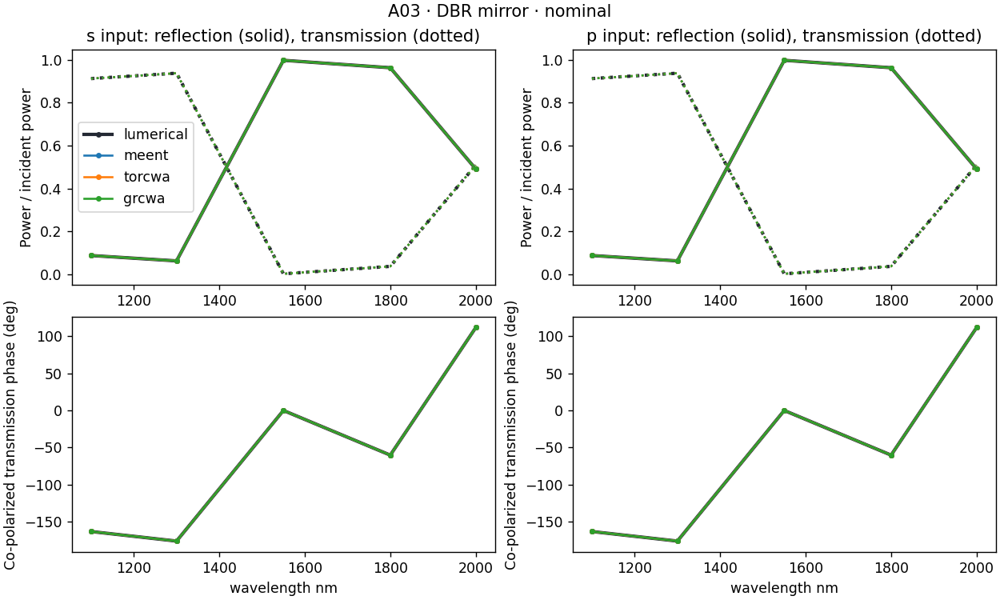

Geometry, additional spectra, diffraction orders and solver differences

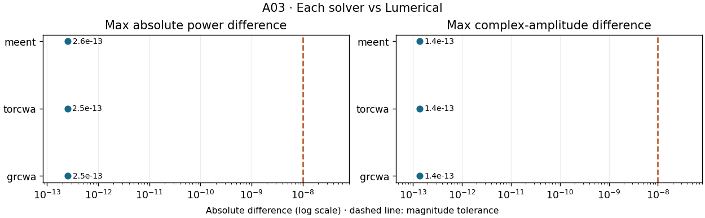

### A04

**Absorbing metal film**

[Notebook, physical model and applications](cases/A/A04/A04.ipynb)

| Solver pair | Matched points | Max ΔR | Max ΔT | Max ΔA | Max order ΔP | Max \|Δamplitude\| | Max phase Δ (deg) | Worst amplitude point | Status |
| --- | --- | --- | --- | --- | --- | --- | --- | --- | --- |
| reference / meent | 3/3 | 5.55e-16 | 2.78e-17 | 5.55e-16 | 5.55e-16 | 1.57e-16 | 7.18e-15 | 0 | PASS |
| reference / torcwa | 3/3 | 4.44e-16 | 2.08e-17 | 4.44e-16 | 4.44e-16 | 2.24e-16 | 8.92e-15 | 0 | PASS |
| reference / grcwa | 3/3 | 2.22e-16 | 1.39e-17 | 2.22e-16 | 2.22e-16 | 1.14e-16 | 7.01e-15 | 0 | PASS |
| reference / lumerical | 3/3 | 1.67e-15 | 4.16e-17 | 1.78e-15 | 1.67e-15 | 5.25e-15 | 3.03e-13 | 2 | PASS |
| meent / torcwa | 3/3 | 3.33e-16 | 4.86e-17 | 3.33e-16 | 3.33e-16 | 1.39e-16 | 1.4e-14 | 0 | PASS |
| meent / grcwa | 3/3 | 5.55e-16 | 2.08e-17 | 5.55e-16 | 5.55e-16 | 1.39e-16 | 7.29e-15 | 1 | PASS |
| meent / lumerical | 3/3 | 1.33e-15 | 6.94e-17 | 1.44e-15 | 1.33e-15 | 5.25e-15 | 3.04e-13 | 2 | PASS |
| torcwa / grcwa | 3/3 | 2.22e-16 | 3.47e-17 | 2.22e-16 | 2.22e-16 | 1.11e-16 | 1.66e-14 | 0 | PASS |
| torcwa / lumerical | 3/3 | 1.33e-15 | 2.78e-17 | 1.33e-15 | 1.33e-15 | 5.16e-15 | 2.98e-13 | 2 | PASS |
| grcwa / lumerical | 3/3 | 1.55e-15 | 5.55e-17 | 1.55e-15 | 1.55e-15 | 5.19e-15 | 2.99e-13 | 2 | PASS |

Geometry, additional spectra, diffraction orders and solver differences

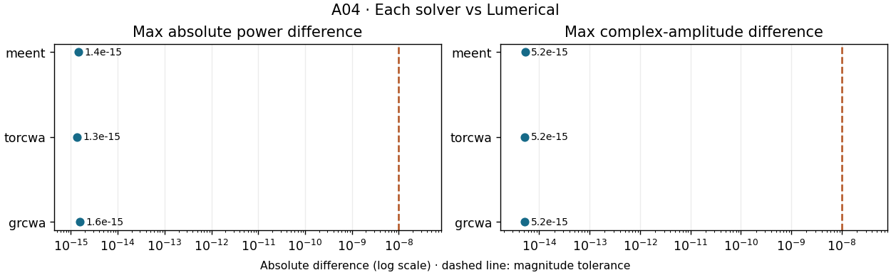

### B01

**Binary dielectric grating**

[Notebook, physical model and applications](cases/B/B01/B01.ipynb) · [Diagnosis](PERIODIC_DIAGNOSIS.md#b01)

| Solver pair | Matched points | Max ΔR | Max ΔT | Max ΔA | Max order ΔP | Max \|Δamplitude\| | Max phase Δ (deg) | Worst amplitude point | Status |
| --- | --- | --- | --- | --- | --- | --- | --- | --- | --- |
| meent / torcwa | 4/4 | 0.00297 | 0.00297 | 1.05e-14 | 0.00818 | 0.0263 | 4.72 | 0 | INCONCLUSIVE |
| meent / grcwa | 4/4 | 0.00297 | 0.00297 | 5.14e-14 | 0.00818 | 0.0263 | 4.72 | 0 | INCONCLUSIVE |
| meent / lumerical | 4/4 | 0.00168 | 0.00168 | 7.06e-14 | 0.0037 | 0.0218 | 4.63 | 0 | INCONCLUSIVE |
| torcwa / grcwa | 4/4 | 4.55e-14 | 7.11e-15 | 4.56e-14 | 2.42e-14 | 9.83e-14 | 3.1e-11 | 0 | INCONCLUSIVE |
| torcwa / lumerical | 4/4 | 0.00139 | 0.00139 | 7.08e-14 | 0.00448 | 0.0207 | 4.31 | 0 | INCONCLUSIVE |
| grcwa / lumerical | 4/4 | 0.00139 | 0.00139 | 6.63e-14 | 0.00448 | 0.0207 | 4.31 | 0 | INCONCLUSIVE |

Geometry, additional spectra, diffraction orders and solver differences

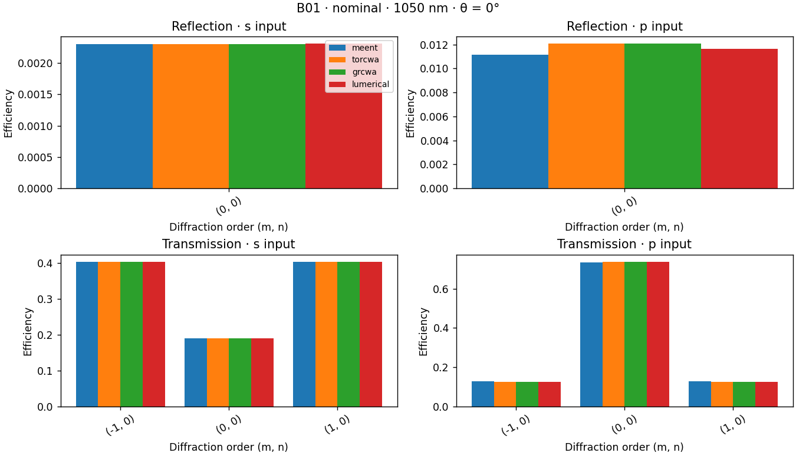

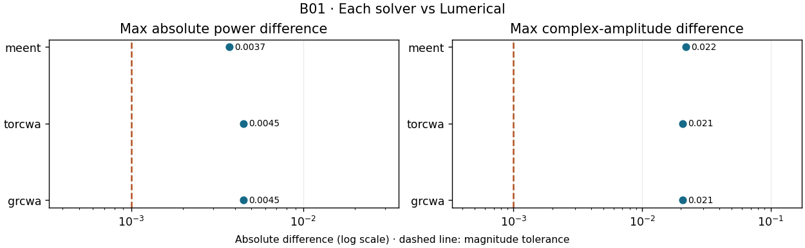

### B02

**High-contrast grating**

[Notebook, physical model and applications](cases/B/B02/B02.ipynb) · [Diagnosis](PERIODIC_DIAGNOSIS.md#b02)

| Solver pair | Matched points | Max ΔR | Max ΔT | Max ΔA | Max order ΔP | Max \|Δamplitude\| | Max phase Δ (deg) | Worst amplitude point | Status |
| --- | --- | --- | --- | --- | --- | --- | --- | --- | --- |
| meent / torcwa | 5/5 | 0.116 | 0.116 | 3.77e-15 | 0.116 | 0.147 | 9.66 | 0 | INCONCLUSIVE |
| meent / grcwa | 5/5 | 0.116 | 0.116 | 1.75e-14 | 0.116 | 0.147 | 9.66 | 0 | INCONCLUSIVE |
| meent / lumerical | 5/5 | 0.0588 | 0.0588 | 1.24e-13 | 0.0588 | 0.0731 | 4.88 | 0 | INCONCLUSIVE |
| torcwa / grcwa | 5/5 | 1.93e-13 | 1.78e-13 | 1.42e-14 | 1.93e-13 | 1.97e-13 | 6.33e-12 | 4 | INCONCLUSIVE |
| torcwa / lumerical | 5/5 | 0.0576 | 0.0576 | 1.27e-13 | 0.0576 | 0.074 | 4.78 | 0 | INCONCLUSIVE |
| grcwa / lumerical | 5/5 | 0.0576 | 0.0576 | 1.41e-13 | 0.0576 | 0.074 | 4.78 | 0 | INCONCLUSIVE |

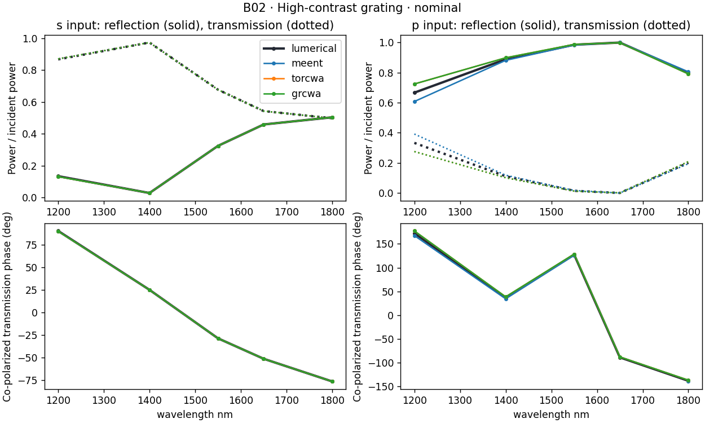

Geometry, additional spectra, diffraction orders and solver differences

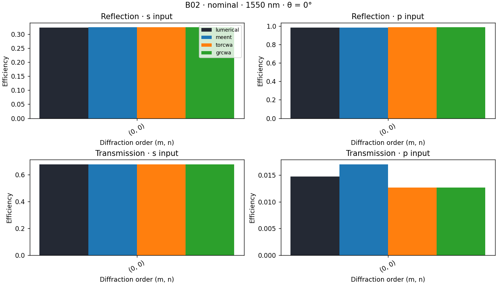

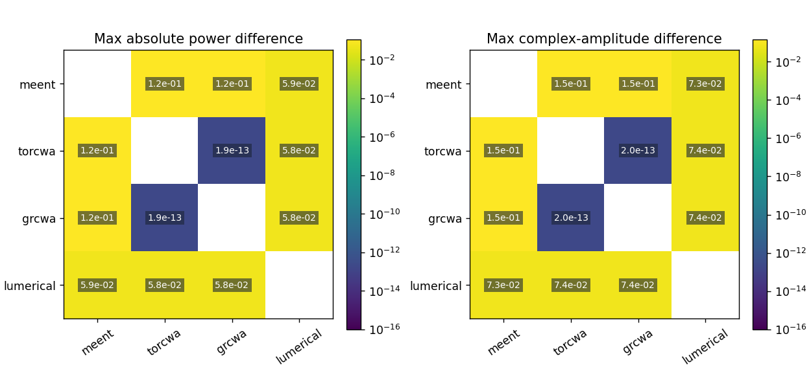

### B03

**Conical incidence**

[Notebook, physical model and applications](cases/B/B03/B03.ipynb) · [Diagnosis](PERIODIC_DIAGNOSIS.md#b03)

| Solver pair | Matched points | Max ΔR | Max ΔT | Max ΔA | Max order ΔP | Max \|Δamplitude\| | Max phase Δ (deg) | Worst amplitude point | Status |
| --- | --- | --- | --- | --- | --- | --- | --- | --- | --- |
| meent / torcwa | 5/5 | 0.00387 | 0.00387 | 3.1e-14 | 0.00628 | 0.0158 | 7.7 | 0 | INCONCLUSIVE |
| meent / grcwa | 5/5 | 0.00387 | 0.00387 | 2.45e-14 | 0.00628 | 0.0158 | 7.7 | 0 | INCONCLUSIVE |
| meent / lumerical | 5/5 | 0.00196 | 0.00196 | 4.41e-13 | 0.00326 | 0.0177 | 4.44 | 1 | INCONCLUSIVE |
| torcwa / grcwa | 5/5 | 1.2e-14 | 4.42e-14 | 5.55e-14 | 4.18e-14 | 1.3e-13 | 4.69e-11 | 4 | INCONCLUSIVE |
| torcwa / lumerical | 5/5 | 0.00191 | 0.00191 | 4.38e-13 | 0.00303 | 0.017 | 5.76 | 0 | INCONCLUSIVE |
| grcwa / lumerical | 5/5 | 0.00191 | 0.00191 | 4.37e-13 | 0.00303 | 0.017 | 5.76 | 0 | INCONCLUSIVE |

Geometry, additional spectra, diffraction orders and solver differences

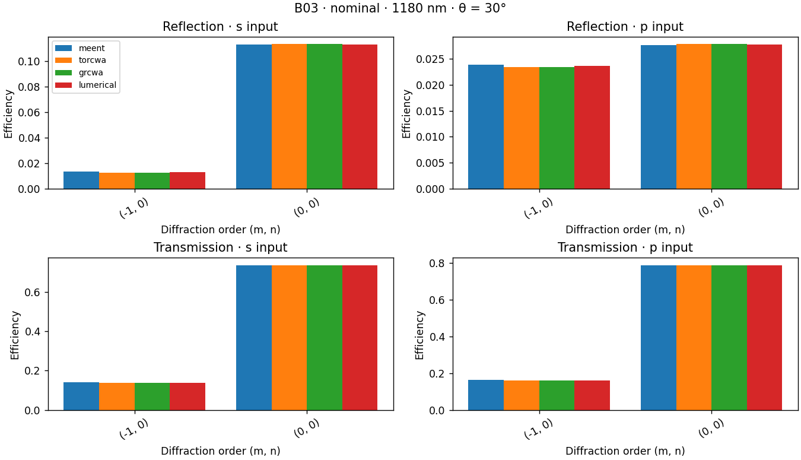

### B04

**Trapezoidal grating**

[Notebook, physical model and applications](cases/B/B04/B04.ipynb) · [Diagnosis](PERIODIC_DIAGNOSIS.md#b04)

| Solver pair | Matched points | Max ΔR | Max ΔT | Max ΔA | Max order ΔP | Max \|Δamplitude\| | Max phase Δ (deg) | Worst amplitude point | Status |
| --- | --- | --- | --- | --- | --- | --- | --- | --- | --- |
| meent / torcwa | 4/4 | 0.000306 | 0.000306 | 7.03e-14 | 0.00579 | 0.0152 | 4.9 | 0 | INCONCLUSIVE |
| meent / grcwa | 4/4 | 0.000306 | 0.000306 | 6.82e-14 | 0.00579 | 0.0152 | 4.9 | 0 | INCONCLUSIVE |
| meent / lumerical | 4/4 | 0.000573 | 0.000573 | 4.12e-14 | 0.004 | 0.0188 | 5.08 | 0 | INCONCLUSIVE |
| torcwa / grcwa | 4/4 | 8.43e-15 | 1.01e-14 | 8.66e-15 | 8.43e-15 | 6.25e-14 | 2.36e-11 | 2 | INCONCLUSIVE |
| torcwa / lumerical | 4/4 | 0.00053 | 0.00053 | 2.91e-14 | 0.00178 | 0.0153 | 3.83 | 0 | INCONCLUSIVE |
| grcwa / lumerical | 4/4 | 0.00053 | 0.00053 | 2.7e-14 | 0.00178 | 0.0153 | 3.83 | 0 | INCONCLUSIVE |

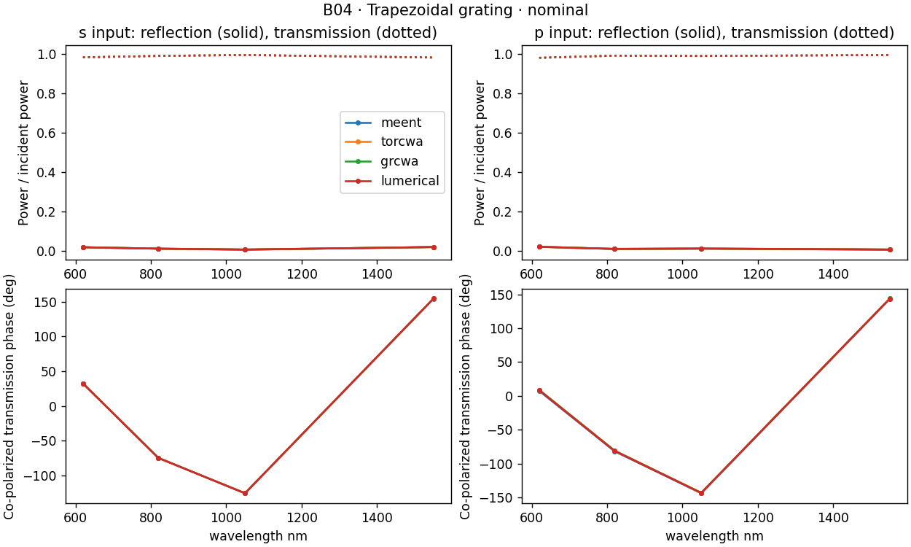

Geometry, additional spectra, diffraction orders and solver differences

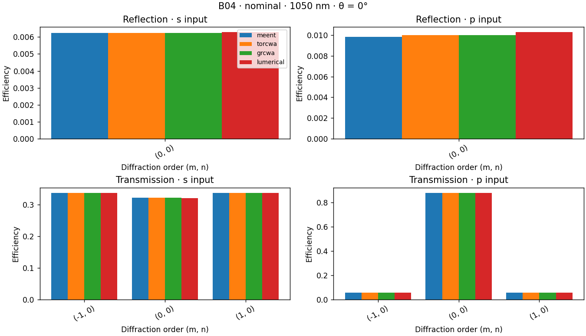

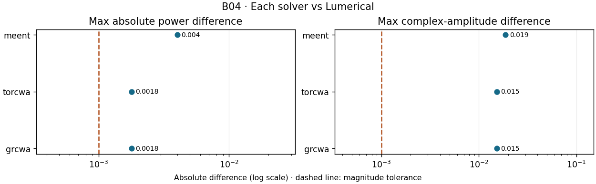

### B05

**Wire-grid polarizer**

[Notebook, physical model and applications](cases/B/B05/B05.ipynb) · [Diagnosis](PERIODIC_DIAGNOSIS.md#b05)

| Solver pair | Matched points | Max ΔR | Max ΔT | Max ΔA | Max order ΔP | Max \|Δamplitude\| | Max phase Δ (deg) | Worst amplitude point | Status |
| --- | --- | --- | --- | --- | --- | --- | --- | --- | --- |
| meent / torcwa | 3/3 | 0.116 | 0.268 | 0.152 | 0.268 | 0.203 | 8.67 | 0 | INCONCLUSIVE |
| meent / grcwa | 3/3 | 0.116 | 0.268 | 0.152 | 0.268 | 0.203 | 8.67 | 0 | INCONCLUSIVE |
| meent / lumerical | 3/3 | 0.016 | 0.0191 | 0.0031 | 0.0191 | 0.0281 | 1.61 | 0 | INCONCLUSIVE |
| torcwa / grcwa | 3/3 | 2.75e-13 | 3.98e-13 | 1.23e-13 | 3.98e-13 | 3.89e-13 | 2.57e-11 | 2 | INCONCLUSIVE |
| torcwa / lumerical | 3/3 | 0.0995 | 0.248 | 0.149 | 0.248 | 0.18 | 7.31 | 0 | INCONCLUSIVE |
| grcwa / lumerical | 3/3 | 0.0995 | 0.248 | 0.149 | 0.248 | 0.18 | 7.31 | 0 | INCONCLUSIVE |

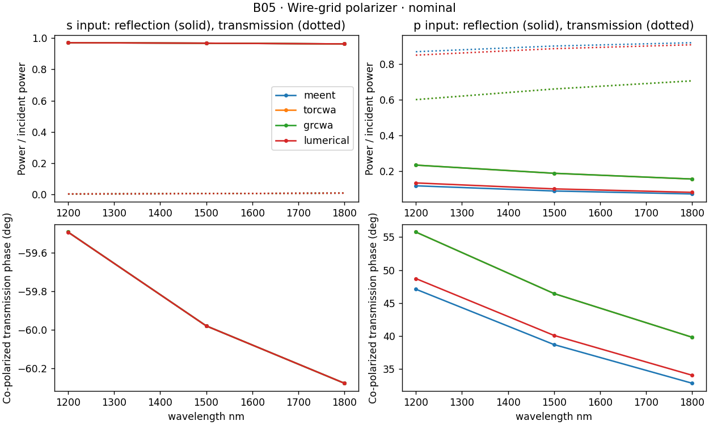

Geometry, additional spectra, diffraction orders and solver differences

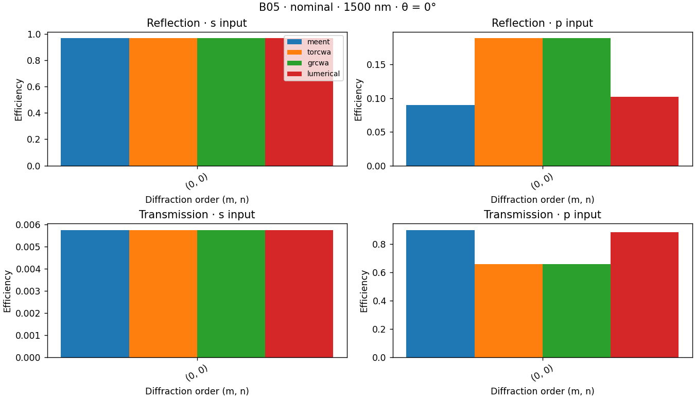

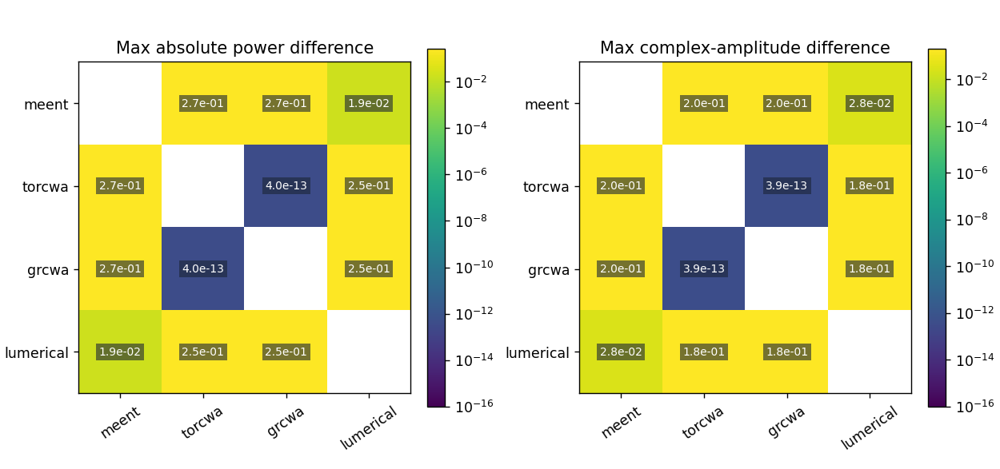

### B06

**Volume index grating**

[Notebook, physical model and applications](cases/B/B06/B06.ipynb) · [Diagnosis](PERIODIC_DIAGNOSIS.md#b06)

| Solver pair | Matched points | Max ΔR | Max ΔT | Max ΔA | Max order ΔP | Max \|Δamplitude\| | Max phase Δ (deg) | Worst amplitude point | Status |
| --- | --- | --- | --- | --- | --- | --- | --- | --- | --- |
| meent / torcwa | 7/7 | 1.74e-08 | 1.74e-08 | 4.2e-14 | 9.06e-05 | 8.69e-05 | 0.00623 | 2 | INCONCLUSIVE |
| meent / grcwa | 7/7 | 1.74e-08 | 1.74e-08 | 6.65e-14 | 9.06e-05 | 8.69e-05 | 0.00623 | 2 | INCONCLUSIVE |
| meent / lumerical | 7/7 | 1.53e-08 | 1.53e-08 | 4.54e-13 | 7.96e-05 | 0.0196 | 2.65 | 3 | INCONCLUSIVE |
| torcwa / grcwa | 7/7 | 5.52e-14 | 3.06e-14 | 2.81e-14 | 7.7e-14 | 1.08e-11 | 1.74e-11 | 5 | INCONCLUSIVE |
| torcwa / lumerical | 7/7 | 3.28e-08 | 3.28e-08 | 4.72e-13 | 0.00017 | 0.0196 | 2.65 | 3 | INCONCLUSIVE |
| grcwa / lumerical | 7/7 | 3.28e-08 | 3.28e-08 | 4.96e-13 | 0.00017 | 0.0196 | 2.65 | 3 | INCONCLUSIVE |

Geometry, additional spectra, diffraction orders and solver differences

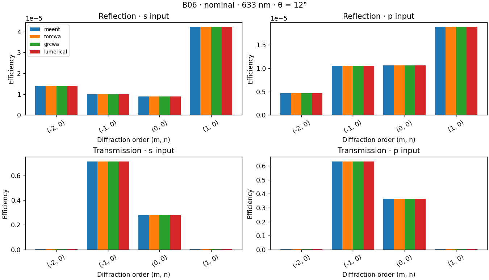

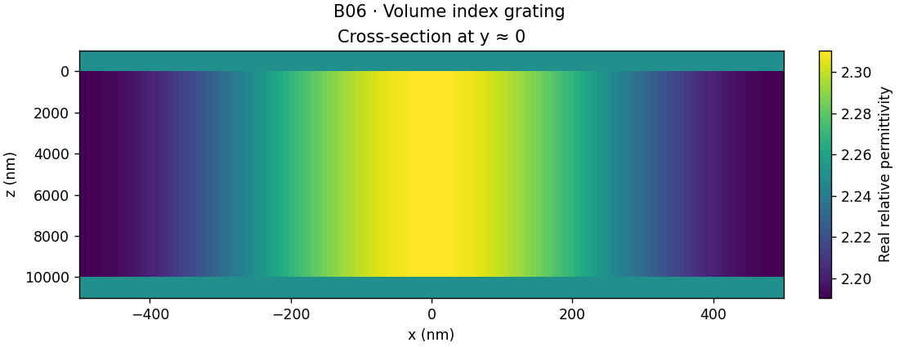

### C01

**Metal nanohole array**

[Notebook, physical model and applications](cases/C/C01/C01.ipynb) · [Diagnosis](PERIODIC_DIAGNOSIS.md#c01)

| Solver pair | Matched points | Max ΔR | Max ΔT | Max ΔA | Max order ΔP | Max \|Δamplitude\| | Max phase Δ (deg) | Worst amplitude point | Status |
| --- | --- | --- | --- | --- | --- | --- | --- | --- | --- |
| meent / torcwa | 5/5 | 0.106 | 0.126 | 0.0362 | 0.106 | 0.117 | 9.33 | 0 | INCONCLUSIVE |
| meent / grcwa | 5/5 | 0.106 | 0.126 | 0.0362 | 0.106 | 0.117 | 9.33 | 0 | INCONCLUSIVE |
| meent / lumerical | 5/5 | 0.136 | 0.141 | 0.0172 | 0.136 | 0.103 | 23.7 | 3 | INCONCLUSIVE |
| torcwa / grcwa | 5/5 | 2.66e-15 | 3.28e-15 | 2.22e-15 | 2.66e-15 | 2.93e-15 | 7.06e-13 | 0 | INCONCLUSIVE |
| torcwa / lumerical | 5/5 | 0.0298 | 0.0507 | 0.0209 | 0.0298 | 0.0524 | 7.67 | 0 | INCONCLUSIVE |
| grcwa / lumerical | 5/5 | 0.0298 | 0.0507 | 0.0209 | 0.0298 | 0.0524 | 7.67 | 0 | INCONCLUSIVE |

Geometry, additional spectra, diffraction orders and solver differences

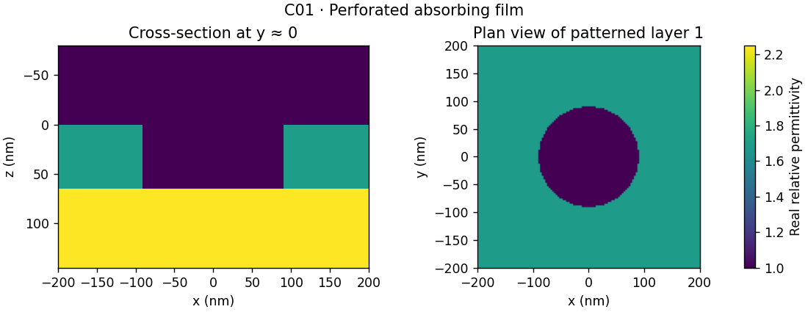

### C02

**Photonic crystal slab**

[Notebook, physical model and applications](cases/C/C02/C02.ipynb) · [Diagnosis](PERIODIC_DIAGNOSIS.md#c02)

| Solver pair | Matched points | Max ΔR | Max ΔT | Max ΔA | Max order ΔP | Max \|Δamplitude\| | Max phase Δ (deg) | Worst amplitude point | Status |
| --- | --- | --- | --- | --- | --- | --- | --- | --- | --- |
| meent / torcwa | 5/5 | 0.991 | 0.991 | 2.09e-13 | 0.991 | 1.02 | 120 | 2 | INCONCLUSIVE |
| meent / grcwa | 5/5 | 0.991 | 0.991 | 4.61e-13 | 0.991 | 1.02 | 120 | 2 | INCONCLUSIVE |
| meent / lumerical | 5/5 | 0.962 | 0.962 | 7.9e-13 | 0.962 | 0.965 | 115 | 3 | INCONCLUSIVE |
| torcwa / grcwa | 5/5 | 3.22e-13 | 3.02e-13 | 5.2e-13 | 3.22e-13 | 1.86e-12 | 1.07e-10 | 1 | INCONCLUSIVE |
| torcwa / lumerical | 5/5 | 0.459 | 0.459 | 8.19e-13 | 0.459 | 0.464 | 27.8 | 2 | INCONCLUSIVE |
| grcwa / lumerical | 5/5 | 0.459 | 0.459 | 1.25e-12 | 0.459 | 0.464 | 27.8 | 2 | INCONCLUSIVE |

Geometry, additional spectra, diffraction orders and solver differences

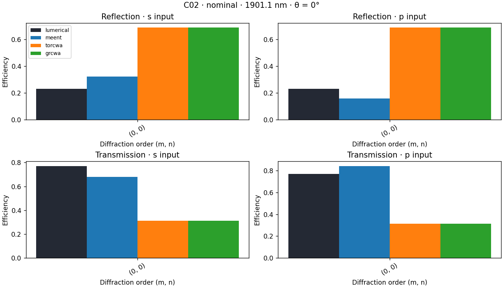

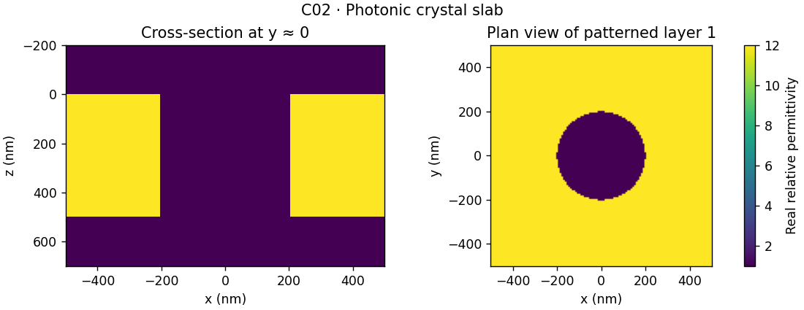

### C03

**Cylindrical meta-atom**

[Notebook, physical model and applications](cases/C/C03/C03.ipynb) · [Diagnosis](PERIODIC_DIAGNOSIS.md#c03)

| Solver pair | Matched points | Max ΔR | Max ΔT | Max ΔA | Max order ΔP | Max \|Δamplitude\| | Max phase Δ (deg) | Worst amplitude point | Status |
| --- | --- | --- | --- | --- | --- | --- | --- | --- | --- |
| meent / torcwa | 5/5 | 0.0188 | 0.0188 | 2.2e-14 | 0.0188 | 0.266 | 15.4 | 2 | INCONCLUSIVE |
| meent / grcwa | 5/5 | 0.0188 | 0.0188 | 4.57e-14 | 0.0188 | 0.266 | 15.4 | 2 | INCONCLUSIVE |
| meent / lumerical | 5/5 | 0.0124 | 0.0124 | 1.25e-13 | 0.0124 | 0.127 | 7.59 | 3 | INCONCLUSIVE |
| torcwa / grcwa | 5/5 | 3.05e-14 | 3.42e-14 | 3.87e-14 | 3.42e-14 | 1.88e-13 | 1.14e-11 | 3 | INCONCLUSIVE |
| torcwa / lumerical | 5/5 | 0.00637 | 0.00637 | 1.33e-13 | 0.00637 | 0.14 | 8.12 | 2 | INCONCLUSIVE |
| grcwa / lumerical | 5/5 | 0.00637 | 0.00637 | 1.17e-13 | 0.00637 | 0.14 | 8.12 | 2 | INCONCLUSIVE |

Geometry, additional spectra, diffraction orders and solver differences

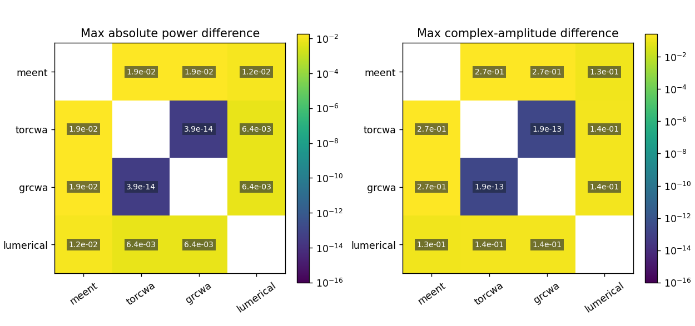

### C04

**Rotated nanofin**

[Notebook, physical model and applications](cases/C/C04/C04.ipynb) · [Diagnosis](PERIODIC_DIAGNOSIS.md#c04)

| Solver pair | Matched points | Max ΔR | Max ΔT | Max ΔA | Max order ΔP | Max \|Δamplitude\| | Max phase Δ (deg) | Worst amplitude point | Status |
| --- | --- | --- | --- | --- | --- | --- | --- | --- | --- |
| meent / torcwa | 5/5 | 0.148 | 0.148 | 4.17e-13 | 0.148 | 0.345 | 33.6 | 2 | INCONCLUSIVE |
| meent / grcwa | 5/5 | 0.148 | 0.148 | 7.66e-14 | 0.148 | 0.345 | 33.6 | 2 | INCONCLUSIVE |
| meent / lumerical | 5/5 | 0.0671 | 0.0671 | 2.22e-13 | 0.0671 | 0.374 | 120 | 2 | INCONCLUSIVE |
| torcwa / grcwa | 5/5 | 9.95e-13 | 1.05e-12 | 3.41e-13 | 1.05e-12 | 9.58e-13 | 1.91e-10 | 2 | INCONCLUSIVE |
| torcwa / lumerical | 5/5 | 0.0813 | 0.0813 | 3.76e-13 | 0.0813 | 0.468 | 95 | 2 | INCONCLUSIVE |
| grcwa / lumerical | 5/5 | 0.0813 | 0.0813 | 2.31e-13 | 0.0813 | 0.468 | 95 | 2 | INCONCLUSIVE |

Geometry, additional spectra, diffraction orders and solver differences

### C05

**Shifted bilayer**

[Notebook, physical model and applications](cases/C/C05/C05.ipynb) · [Diagnosis](PERIODIC_DIAGNOSIS.md#c05)

| Solver pair | Matched points | Max ΔR | Max ΔT | Max ΔA | Max order ΔP | Max \|Δamplitude\| | Max phase Δ (deg) | Worst amplitude point | Status |
| --- | --- | --- | --- | --- | --- | --- | --- | --- | --- |
| meent / torcwa | 12/12 | 0.0208 | 0.0208 | 1.07e-14 | 0.0208 | 0.123 | 9.89 | 8 | INCONCLUSIVE |
| meent / grcwa | 12/12 | 0.0208 | 0.0208 | 4.91e-14 | 0.0208 | 0.123 | 9.89 | 8 | INCONCLUSIVE |
| meent / lumerical | 12/12 | 0.00679 | 0.00679 | 1.33e-13 | 0.00679 | 0.053 | 5.71 | 8 | INCONCLUSIVE |
| torcwa / grcwa | 12/12 | 6.39e-14 | 1.84e-14 | 4.55e-14 | 6.39e-14 | 5.22e-13 | 2.44e-10 | 11 | INCONCLUSIVE |
| torcwa / lumerical | 12/12 | 0.014 | 0.014 | 1.41e-13 | 0.014 | 0.0724 | 11 | 0 | INCONCLUSIVE |
| grcwa / lumerical | 12/12 | 0.014 | 0.014 | 1.23e-13 | 0.014 | 0.0724 | 11 | 0 | INCONCLUSIVE |

Geometry, additional spectra, diffraction orders and solver differences

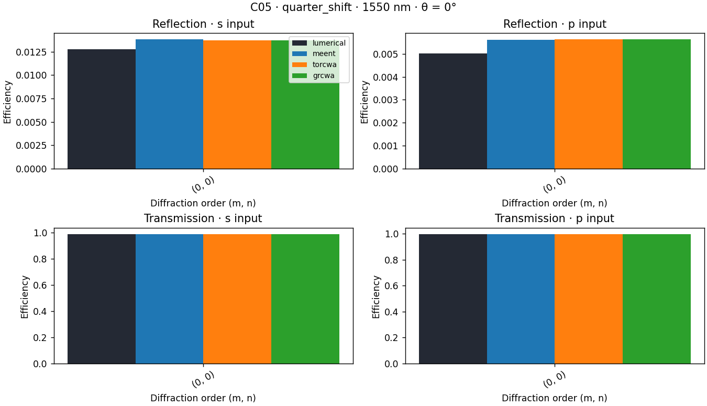

### C06

**Metagrating supercell**

[Notebook, physical model and applications](cases/C/C06/C06.ipynb) · [Diagnosis](PERIODIC_DIAGNOSIS.md#c06)

| Solver pair | Matched points | Max ΔR | Max ΔT | Max ΔA | Max order ΔP | Max \|Δamplitude\| | Max phase Δ (deg) | Worst amplitude point | Status |
| --- | --- | --- | --- | --- | --- | --- | --- | --- | --- |
| meent / torcwa | 4/4 | 0.204 | 0.204 | 8.39e-14 | 0.537 | 1.21 | 170 | 0 | INCONCLUSIVE |
| meent / grcwa | 4/4 | 0.204 | 0.204 | 1.45e-13 | 0.537 | 1.21 | 170 | 0 | INCONCLUSIVE |
| meent / lumerical | 4/4 | 0.209 | 0.209 | 1.88e-13 | 0.664 | 1.11 | 179 | 1 | INCONCLUSIVE |
| torcwa / grcwa | 4/4 | 1.67e-13 | 1.4e-13 | 6.08e-14 | 3.05e-13 | 4.81e-13 | 1.25e-10 | 2 | INCONCLUSIVE |
| torcwa / lumerical | 4/4 | 0.186 | 0.186 | 2.19e-13 | 0.238 | 0.824 | 176 | 0 | INCONCLUSIVE |
| grcwa / lumerical | 4/4 | 0.186 | 0.186 | 2.8e-13 | 0.238 | 0.824 | 176 | 0 | INCONCLUSIVE |

Geometry, additional spectra, diffraction orders and solver differences

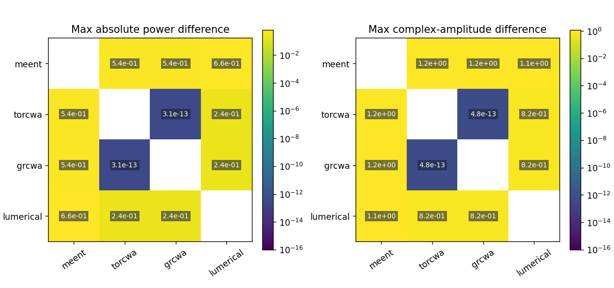

## Conclusion

**Planar validation.** 4/4 cases pass. Against the independent Fresnel or multilayer reference, the largest absolute power and complex-amplitude differences are 2.54e-13 and 1.59e-13, respectively. This verifies the tested planar normalization, polarization and phase conventions.

**Periodic structures.** 12/12 cases are inconclusive under the reported settings. The largest observed power discrepancy is 0.991 in C02 (Photonic crystal slab). Across the periodic cases, grcwa and torcwa differ by at most 1.05e-12 in power and 1.08e-11 in complex amplitude at the tested points. Their common raster can produce shared discretization error. These results support a comparison of consistency under the reported settings.

**Periodic diagnosis.** Matching the finite-order material operator resolves the selected Meent–grcwa differences. The detailed study documents resonance shifts in C02, order-power redistribution in C06, and an order-dependent phase ramp in the archived B06 Lumerical results. [Experiments and case-by-case findings](PERIODIC_DIAGNOSIS.md).
