# RCWA Benchmark Against Lumerical

Profile **quick** · **91 excitation points** · **16 cases** · s and p incidence at each point. [Numerical dataset](results/benchmark.json) · [Periodic-case diagnosis](PERIODIC_DIAGNOSIS.md) · [Conclusion](#conclusion)

Each reported difference uses Lumerical as the reference at the same excitation point. The quick profile retains the published solver settings. The [periodic study](PERIODIC_DIAGNOSIS.md) checks the effect of aligning the actual Fourier basis.

## Case overview

| Case | Optical problem | Points | Coverage | Max Δpower | Max \|Δamplitude\| | Status |
| --- | --- | --- | --- | --- | --- | --- |
| [A01](#a01) | Fresnel interface | 14 | 4/4 | 9.63e-14 | 1.59e-13 | PASS |
| [A02](#a02) | Antireflection film | 5 | 4/4 | 1.52e-14 | 8.49e-15 | PASS |
| [A03](#a03) | DBR mirror | 5 | 4/4 | 2.55e-13 | 1.38e-13 | PASS |
| [A04](#a04) | Absorbing metal film | 3 | 4/4 | 1.55e-15 | 5.25e-15 | PASS |
| [B01](#b01) | Binary dielectric grating | 4 | 4/4 | 0.00448 | 0.0218 | INCONCLUSIVE |
| [B02](#b02) | High-contrast grating | 5 | 4/4 | 0.0588 | 0.074 | INCONCLUSIVE |
| [B03](#b03) | Conical incidence | 5 | 4/4 | 0.00326 | 0.0177 | INCONCLUSIVE |
| [B04](#b04) | Trapezoidal grating | 4 | 4/4 | 0.004 | 0.0188 | INCONCLUSIVE |
| [B05](#b05) | Wire-grid polarizer | 3 | 4/4 | 0.248 | 0.18 | INCONCLUSIVE |
| [B06](#b06) | Volume index grating | 7 | 4/4 | 0.00017 | 0.0196 | INCONCLUSIVE |
| [C01](#c01) | Metal nanohole array | 5 | 4/4 | 0.141 | 0.103 | INCONCLUSIVE |
| [C02](#c02) | Photonic crystal slab | 5 | 4/4 | 0.962 | 0.965 | INCONCLUSIVE |
| [C03](#c03) | Cylindrical meta-atom | 5 | 4/4 | 0.0124 | 0.14 | INCONCLUSIVE |
| [C04](#c04) | Rotated nanofin | 5 | 4/4 | 0.0813 | 0.468 | INCONCLUSIVE |
| [C05](#c05) | Shifted bilayer | 12 | 4/4 | 0.014 | 0.0724 | INCONCLUSIVE |
| [C06](#c06) | Metagrating supercell | 4 | 4/4 | 0.664 | 1.11 | INCONCLUSIVE |

Power differences include total reflectance, transmittance, absorptance, and the efficiency of each propagating diffraction order. Amplitudes use the common power-normalized reference. A missing phase metric means that no matched channel exceeds the reporting floor. Point indices are zero-based.

## Solver agreement with Lumerical

| Solver vs Lumerical | Cases | Matched points | Worst Δpower | Worst \|Δamplitude\| | Cases with both deltas ≤ 1e-3 | Cases passed |
| --- | --- | --- | --- | --- | --- | --- |
| meent | 16 | 91 | 0.962 | 1.11 | 4 | 4 |
| torcwa | 16 | 91 | 0.459 | 0.824 | 4 | 4 |
| grcwa | 16 | 91 | 0.459 | 0.824 | 4 | 4 |

The common 1e-3 cutoff is descriptive. A pass also requires full coverage, the case-specific tolerance, the phase tolerance, and convergence evidence.

## Software versions

| Software or runtime | Version or device |
| --- | --- |
| Python | 3.11.8 |
| rcwa-cross-validation | 0.2.0 |
| numpy | 2.4.6 |
| scipy | 1.17.1 |
| matplotlib | 3.10.8 |
| PyYAML | 6.0.3 |
| threadpoolctl | 3.8.0 |
| meent | 0.13.2 |
| grcwa | 0.1.2 |
| torcwa | 0.1.4.2 |
| torch | 2.8.0+cu128 |
| jupyterlab | 4.6.6 |
| ipykernel | 7.4.0 |
| Lumerical RCWA | v252 / build 8.34.4175 |
| PyTorch CUDA runtime | 12.8 |
| torcwa device | NVIDIA GeForce RTX 4060 Laptop GPU |
| Operating system | Windows-10-10.0.22621-SP0 |

## Case comparisons and figures

### A01

**Fresnel interface**

[Notebook, physical model and applications](cases/A/A01/A01.ipynb)

| Solver vs Lumerical | Matched points | Max ΔR | Max ΔT | Max ΔA | Max order ΔP | Max \|Δamplitude\| | Max phase Δ (deg) | Worst amplitude point | Status |
| --- | --- | --- | --- | --- | --- | --- | --- | --- | --- |
| meent | 14/14 | 9.59e-14 | 9.59e-14 | 3.87e-14 | 9.59e-14 | 1.59e-13 | 1.24e-11 | 6 | PASS |
| torcwa | 14/14 | 9.6e-14 | 9.59e-14 | 3.63e-14 | 9.6e-14 | 1.59e-13 | 1.24e-11 | 6 | PASS |
| grcwa | 14/14 | 9.63e-14 | 9.59e-14 | 3.63e-14 | 9.63e-14 | 1.59e-13 | 1.24e-11 | 6 | PASS |

Geometry, additional spectra, diffraction orders and solver differences

### A02

**Antireflection film**

[Notebook, physical model and applications](cases/A/A02/A02.ipynb)

| Solver vs Lumerical | Matched points | Max ΔR | Max ΔT | Max ΔA | Max order ΔP | Max \|Δamplitude\| | Max phase Δ (deg) | Worst amplitude point | Status |
| --- | --- | --- | --- | --- | --- | --- | --- | --- | --- |
| meent | 5/5 | 6.12e-16 | 1.41e-14 | 1.47e-14 | 1.41e-14 | 7.9e-15 | 2.16e-12 | 0 | PASS |
| torcwa | 5/5 | 6.14e-16 | 1.42e-14 | 1.48e-14 | 1.42e-14 | 8.05e-15 | 1.72e-12 | 0 | PASS |
| grcwa | 5/5 | 6.4e-16 | 1.47e-14 | 1.52e-14 | 1.47e-14 | 8.49e-15 | 1.65e-12 | 0 | PASS |

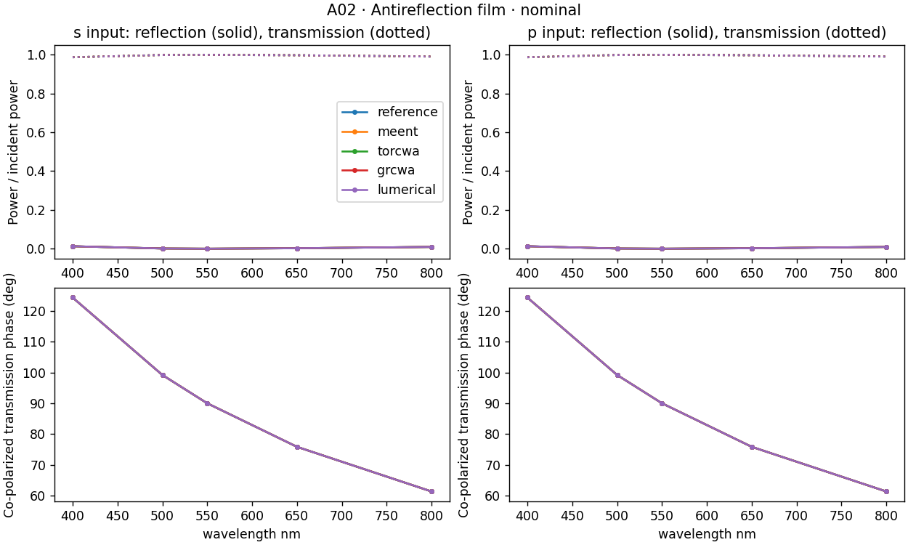

Geometry, additional spectra, diffraction orders and solver differences

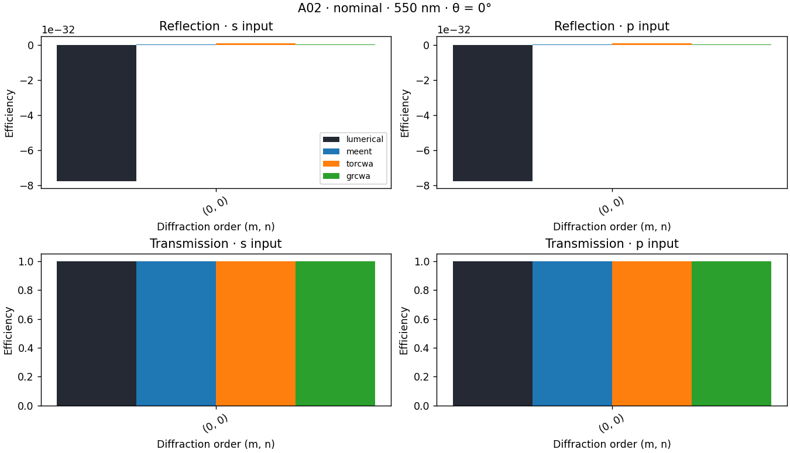

### A03

**DBR mirror**

[Notebook, physical model and applications](cases/A/A03/A03.ipynb)

| Solver vs Lumerical | Matched points | Max ΔR | Max ΔT | Max ΔA | Max order ΔP | Max \|Δamplitude\| | Max phase Δ (deg) | Worst amplitude point | Status |
| --- | --- | --- | --- | --- | --- | --- | --- | --- | --- |
| meent | 5/5 | 2.06e-14 | 2.55e-13 | 2.55e-13 | 2.55e-13 | 1.38e-13 | 1.95e-11 | 1 | PASS |
| torcwa | 5/5 | 2.08e-14 | 2.51e-13 | 2.51e-13 | 2.51e-13 | 1.36e-13 | 1.92e-11 | 1 | PASS |
| grcwa | 5/5 | 1.99e-14 | 2.53e-13 | 2.52e-13 | 2.53e-13 | 1.36e-13 | 1.92e-11 | 1 | PASS |

Geometry, additional spectra, diffraction orders and solver differences

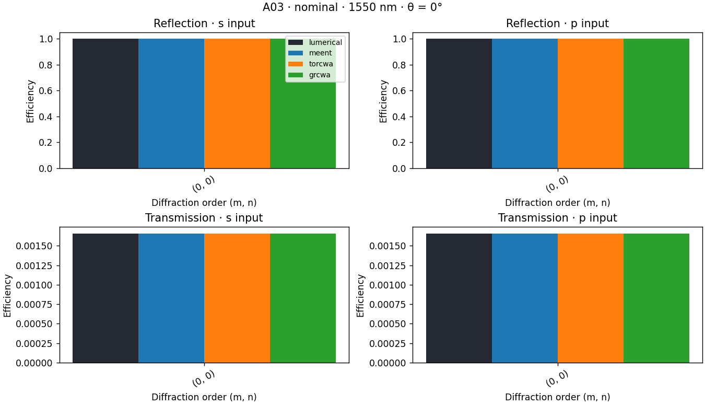

### A04

**Absorbing metal film**

[Notebook, physical model and applications](cases/A/A04/A04.ipynb)

| Solver vs Lumerical | Matched points | Max ΔR | Max ΔT | Max ΔA | Max order ΔP | Max \|Δamplitude\| | Max phase Δ (deg) | Worst amplitude point | Status |
| --- | --- | --- | --- | --- | --- | --- | --- | --- | --- |
| meent | 3/3 | 1.33e-15 | 6.94e-17 | 1.44e-15 | 1.33e-15 | 5.25e-15 | 3.04e-13 | 2 | PASS |
| torcwa | 3/3 | 1.33e-15 | 2.78e-17 | 1.33e-15 | 1.33e-15 | 5.16e-15 | 2.98e-13 | 2 | PASS |
| grcwa | 3/3 | 1.55e-15 | 5.55e-17 | 1.55e-15 | 1.55e-15 | 5.19e-15 | 2.99e-13 | 2 | PASS |

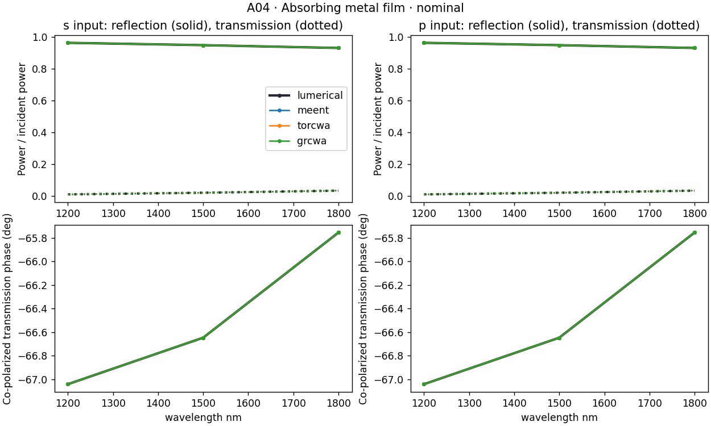

Geometry, additional spectra, diffraction orders and solver differences

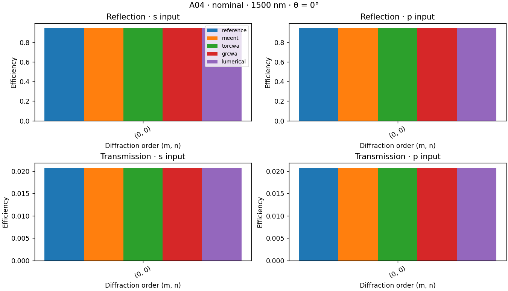

### B01

**Binary dielectric grating**

[Notebook, physical model and applications](cases/B/B01/B01.ipynb) · [Diagnosis](PERIODIC_DIAGNOSIS.md#b01)

| Solver vs Lumerical | Matched points | Max ΔR | Max ΔT | Max ΔA | Max order ΔP | Max \|Δamplitude\| | Max phase Δ (deg) | Worst amplitude point | Status |
| --- | --- | --- | --- | --- | --- | --- | --- | --- | --- |
| meent | 4/4 | 0.00168 | 0.00168 | 7.06e-14 | 0.0037 | 0.0218 | 4.63 | 0 | INCONCLUSIVE |
| torcwa | 4/4 | 0.00139 | 0.00139 | 7.08e-14 | 0.00448 | 0.0207 | 4.31 | 0 | INCONCLUSIVE |
| grcwa | 4/4 | 0.00139 | 0.00139 | 6.63e-14 | 0.00448 | 0.0207 | 4.31 | 0 | INCONCLUSIVE |

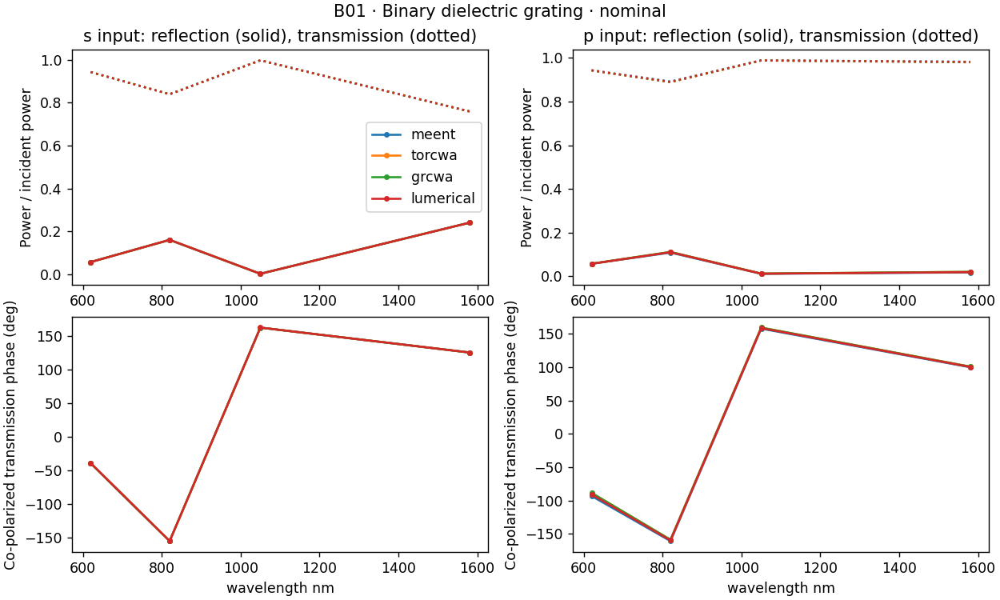

Geometry, additional spectra, diffraction orders and solver differences

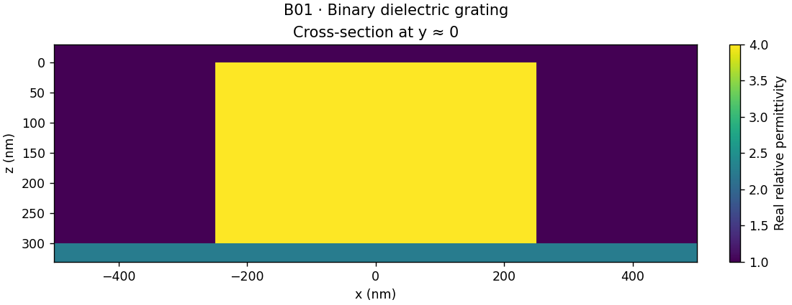

### B02

**High-contrast grating**

[Notebook, physical model and applications](cases/B/B02/B02.ipynb) · [Diagnosis](PERIODIC_DIAGNOSIS.md#b02)

| Solver vs Lumerical | Matched points | Max ΔR | Max ΔT | Max ΔA | Max order ΔP | Max \|Δamplitude\| | Max phase Δ (deg) | Worst amplitude point | Status |
| --- | --- | --- | --- | --- | --- | --- | --- | --- | --- |
| meent | 5/5 | 0.0588 | 0.0588 | 1.24e-13 | 0.0588 | 0.0731 | 4.88 | 0 | INCONCLUSIVE |
| torcwa | 5/5 | 0.0576 | 0.0576 | 1.27e-13 | 0.0576 | 0.074 | 4.78 | 0 | INCONCLUSIVE |
| grcwa | 5/5 | 0.0576 | 0.0576 | 1.41e-13 | 0.0576 | 0.074 | 4.78 | 0 | INCONCLUSIVE |

Geometry, additional spectra, diffraction orders and solver differences

### B03

**Conical incidence**

[Notebook, physical model and applications](cases/B/B03/B03.ipynb) · [Diagnosis](PERIODIC_DIAGNOSIS.md#b03)

| Solver vs Lumerical | Matched points | Max ΔR | Max ΔT | Max ΔA | Max order ΔP | Max \|Δamplitude\| | Max phase Δ (deg) | Worst amplitude point | Status |
| --- | --- | --- | --- | --- | --- | --- | --- | --- | --- |
| meent | 5/5 | 0.00196 | 0.00196 | 4.41e-13 | 0.00326 | 0.0177 | 4.44 | 1 | INCONCLUSIVE |
| torcwa | 5/5 | 0.00191 | 0.00191 | 4.38e-13 | 0.00303 | 0.017 | 5.76 | 0 | INCONCLUSIVE |
| grcwa | 5/5 | 0.00191 | 0.00191 | 4.37e-13 | 0.00303 | 0.017 | 5.76 | 0 | INCONCLUSIVE |

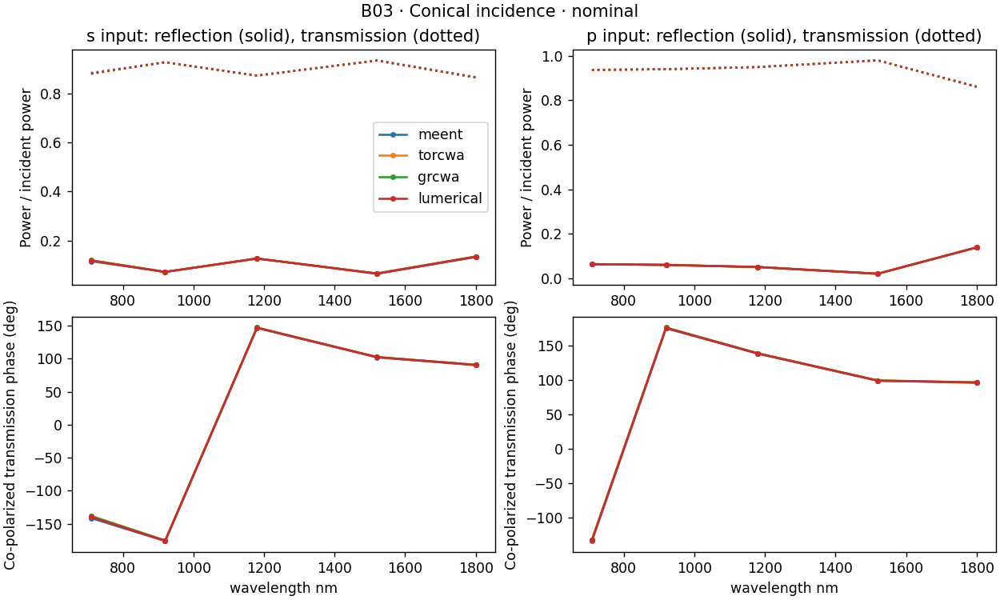

Geometry, additional spectra, diffraction orders and solver differences

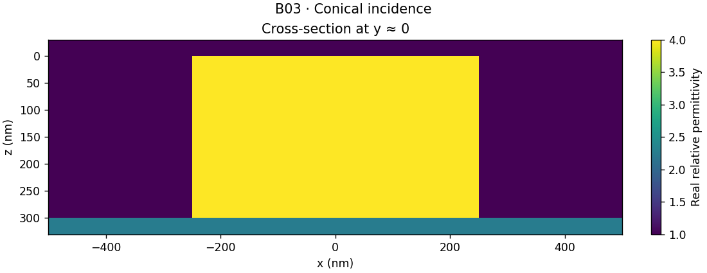

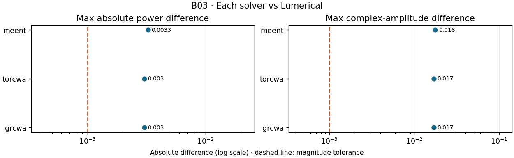

### B04

**Trapezoidal grating**

[Notebook, physical model and applications](cases/B/B04/B04.ipynb) · [Diagnosis](PERIODIC_DIAGNOSIS.md#b04)

| Solver vs Lumerical | Matched points | Max ΔR | Max ΔT | Max ΔA | Max order ΔP | Max \|Δamplitude\| | Max phase Δ (deg) | Worst amplitude point | Status |
| --- | --- | --- | --- | --- | --- | --- | --- | --- | --- |
| meent | 4/4 | 0.000573 | 0.000573 | 4.12e-14 | 0.004 | 0.0188 | 5.08 | 0 | INCONCLUSIVE |
| torcwa | 4/4 | 0.00053 | 0.00053 | 2.91e-14 | 0.00178 | 0.0153 | 3.83 | 0 | INCONCLUSIVE |
| grcwa | 4/4 | 0.00053 | 0.00053 | 2.7e-14 | 0.00178 | 0.0153 | 3.83 | 0 | INCONCLUSIVE |

Geometry, additional spectra, diffraction orders and solver differences

### B05

**Wire-grid polarizer**

[Notebook, physical model and applications](cases/B/B05/B05.ipynb) · [Diagnosis](PERIODIC_DIAGNOSIS.md#b05)

| Solver vs Lumerical | Matched points | Max ΔR | Max ΔT | Max ΔA | Max order ΔP | Max \|Δamplitude\| | Max phase Δ (deg) | Worst amplitude point | Status |
| --- | --- | --- | --- | --- | --- | --- | --- | --- | --- |
| meent | 3/3 | 0.016 | 0.0191 | 0.0031 | 0.0191 | 0.0281 | 1.61 | 0 | INCONCLUSIVE |
| torcwa | 3/3 | 0.0995 | 0.248 | 0.149 | 0.248 | 0.18 | 7.31 | 0 | INCONCLUSIVE |
| grcwa | 3/3 | 0.0995 | 0.248 | 0.149 | 0.248 | 0.18 | 7.31 | 0 | INCONCLUSIVE |

Geometry, additional spectra, diffraction orders and solver differences

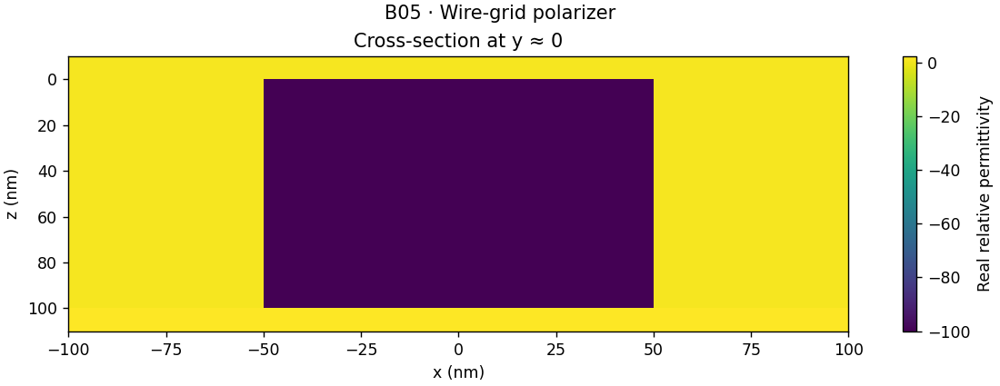

### B06

**Volume index grating**

[Notebook, physical model and applications](cases/B/B06/B06.ipynb) · [Diagnosis](PERIODIC_DIAGNOSIS.md#b06)

| Solver vs Lumerical | Matched points | Max ΔR | Max ΔT | Max ΔA | Max order ΔP | Max \|Δamplitude\| | Max phase Δ (deg) | Worst amplitude point | Status |
| --- | --- | --- | --- | --- | --- | --- | --- | --- | --- |
| meent | 7/7 | 1.53e-08 | 1.53e-08 | 4.54e-13 | 7.96e-05 | 0.0196 | 2.65 | 3 | INCONCLUSIVE |
| torcwa | 7/7 | 3.28e-08 | 3.28e-08 | 4.72e-13 | 0.00017 | 0.0196 | 2.65 | 3 | INCONCLUSIVE |
| grcwa | 7/7 | 3.28e-08 | 3.28e-08 | 4.96e-13 | 0.00017 | 0.0196 | 2.65 | 3 | INCONCLUSIVE |

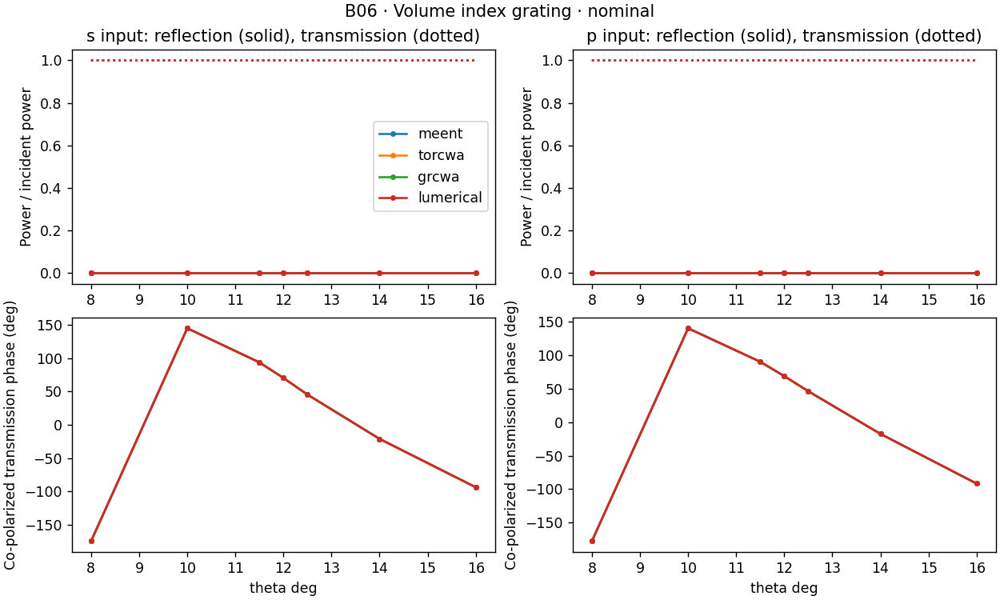

Geometry, additional spectra, diffraction orders and solver differences

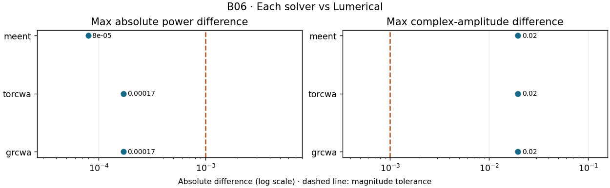

### C01

**Metal nanohole array**

[Notebook, physical model and applications](cases/C/C01/C01.ipynb) · [Diagnosis](PERIODIC_DIAGNOSIS.md#c01)

| Solver vs Lumerical | Matched points | Max ΔR | Max ΔT | Max ΔA | Max order ΔP | Max \|Δamplitude\| | Max phase Δ (deg) | Worst amplitude point | Status |
| --- | --- | --- | --- | --- | --- | --- | --- | --- | --- |
| meent | 5/5 | 0.136 | 0.141 | 0.0172 | 0.136 | 0.103 | 23.7 | 3 | INCONCLUSIVE |
| torcwa | 5/5 | 0.0298 | 0.0507 | 0.0209 | 0.0298 | 0.0524 | 7.67 | 0 | INCONCLUSIVE |
| grcwa | 5/5 | 0.0298 | 0.0507 | 0.0209 | 0.0298 | 0.0524 | 7.67 | 0 | INCONCLUSIVE |

Geometry, additional spectra, diffraction orders and solver differences

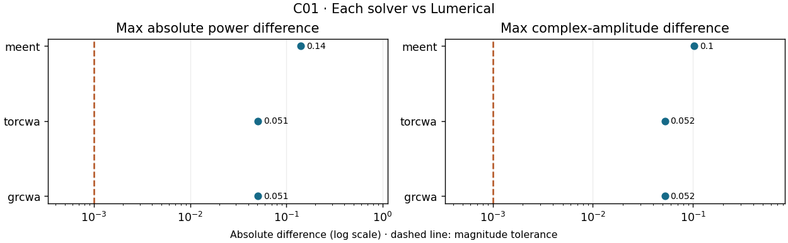

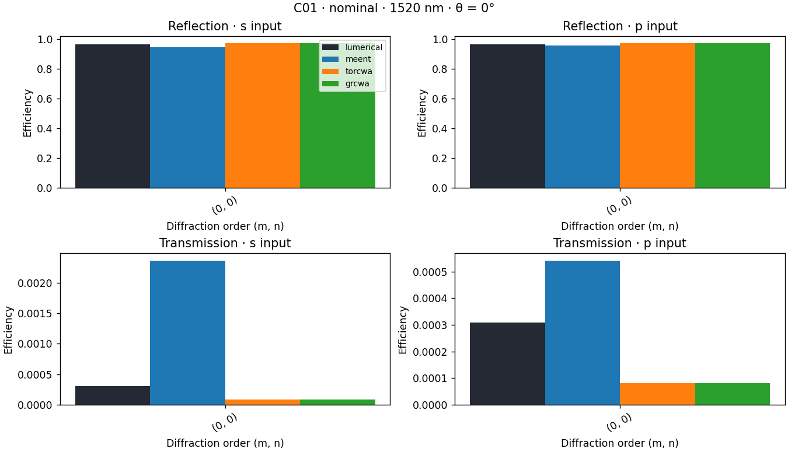

### C02

**Photonic crystal slab**

[Notebook, physical model and applications](cases/C/C02/C02.ipynb) · [Diagnosis](PERIODIC_DIAGNOSIS.md#c02)

| Solver vs Lumerical | Matched points | Max ΔR | Max ΔT | Max ΔA | Max order ΔP | Max \|Δamplitude\| | Max phase Δ (deg) | Worst amplitude point | Status |
| --- | --- | --- | --- | --- | --- | --- | --- | --- | --- |
| meent | 5/5 | 0.962 | 0.962 | 7.9e-13 | 0.962 | 0.965 | 115 | 3 | INCONCLUSIVE |
| torcwa | 5/5 | 0.459 | 0.459 | 8.19e-13 | 0.459 | 0.464 | 27.8 | 2 | INCONCLUSIVE |
| grcwa | 5/5 | 0.459 | 0.459 | 1.25e-12 | 0.459 | 0.464 | 27.8 | 2 | INCONCLUSIVE |

Geometry, additional spectra, diffraction orders and solver differences

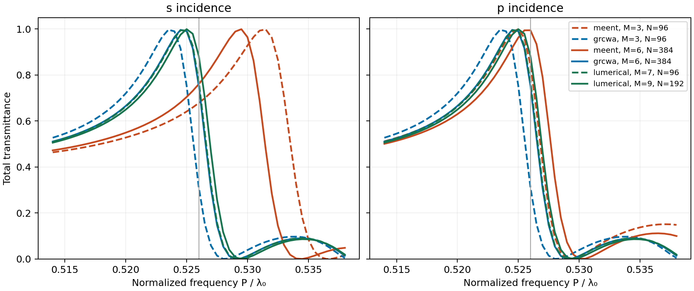

### C03

**Cylindrical meta-atom**

[Notebook, physical model and applications](cases/C/C03/C03.ipynb) · [Diagnosis](PERIODIC_DIAGNOSIS.md#c03)

| Solver vs Lumerical | Matched points | Max ΔR | Max ΔT | Max ΔA | Max order ΔP | Max \|Δamplitude\| | Max phase Δ (deg) | Worst amplitude point | Status |
| --- | --- | --- | --- | --- | --- | --- | --- | --- | --- |
| meent | 5/5 | 0.0124 | 0.0124 | 1.25e-13 | 0.0124 | 0.127 | 7.59 | 3 | INCONCLUSIVE |
| torcwa | 5/5 | 0.00637 | 0.00637 | 1.33e-13 | 0.00637 | 0.14 | 8.12 | 2 | INCONCLUSIVE |
| grcwa | 5/5 | 0.00637 | 0.00637 | 1.17e-13 | 0.00637 | 0.14 | 8.12 | 2 | INCONCLUSIVE |

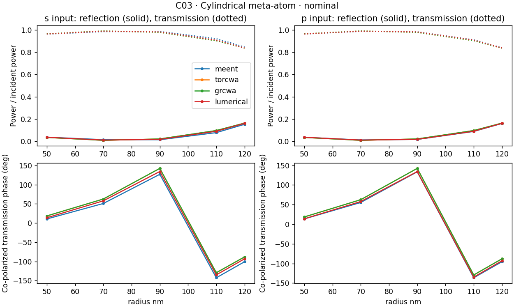

Geometry, additional spectra, diffraction orders and solver differences

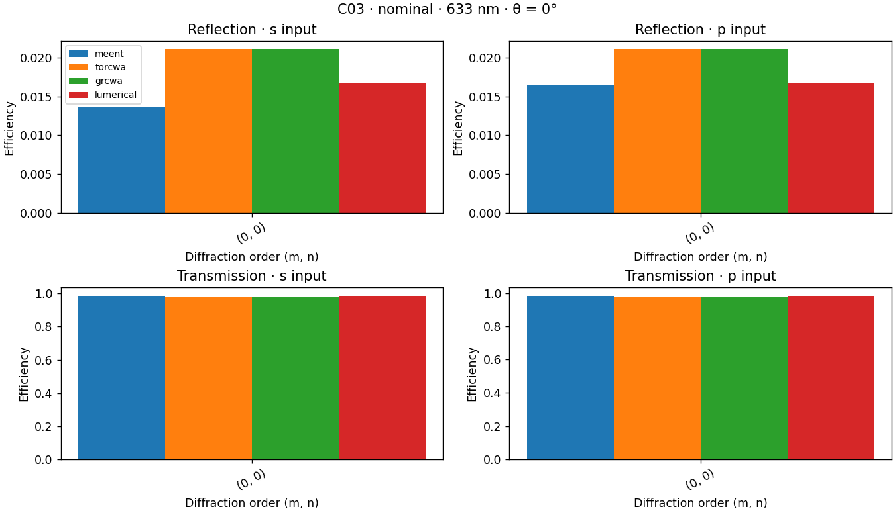

### C04

**Rotated nanofin**

[Notebook, physical model and applications](cases/C/C04/C04.ipynb) · [Diagnosis](PERIODIC_DIAGNOSIS.md#c04)

| Solver vs Lumerical | Matched points | Max ΔR | Max ΔT | Max ΔA | Max order ΔP | Max \|Δamplitude\| | Max phase Δ (deg) | Worst amplitude point | Status |
| --- | --- | --- | --- | --- | --- | --- | --- | --- | --- |
| meent | 5/5 | 0.0671 | 0.0671 | 2.22e-13 | 0.0671 | 0.374 | 120 | 2 | INCONCLUSIVE |
| torcwa | 5/5 | 0.0813 | 0.0813 | 3.76e-13 | 0.0813 | 0.468 | 95 | 2 | INCONCLUSIVE |
| grcwa | 5/5 | 0.0813 | 0.0813 | 2.31e-13 | 0.0813 | 0.468 | 95 | 2 | INCONCLUSIVE |

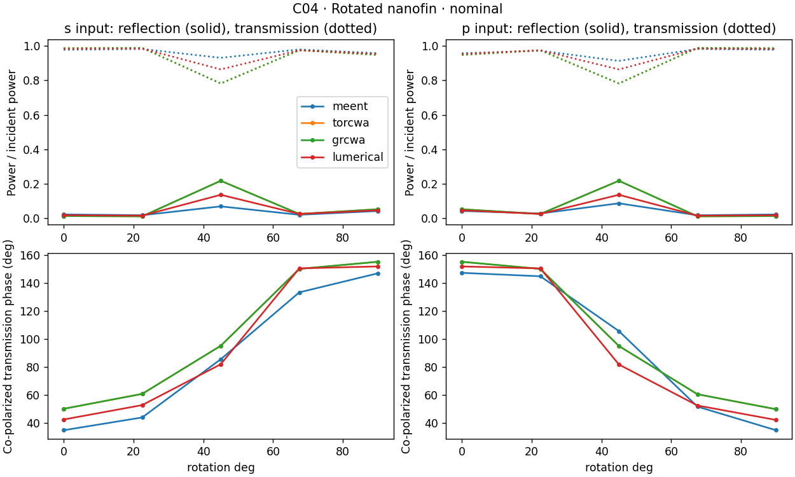

Geometry, additional spectra, diffraction orders and solver differences

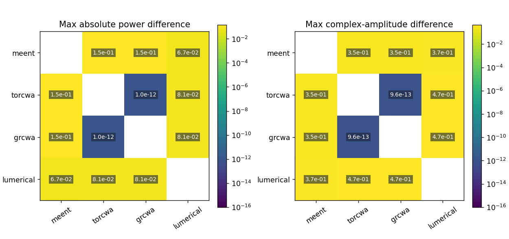

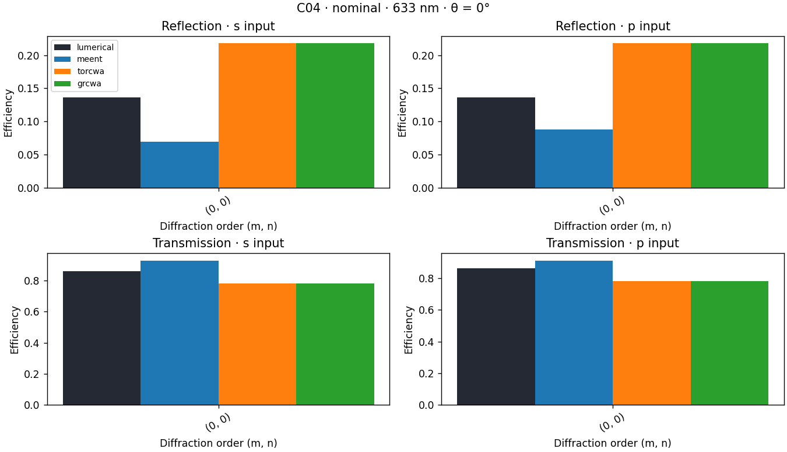

### C05

**Shifted bilayer**

[Notebook, physical model and applications](cases/C/C05/C05.ipynb) · [Diagnosis](PERIODIC_DIAGNOSIS.md#c05)

| Solver vs Lumerical | Matched points | Max ΔR | Max ΔT | Max ΔA | Max order ΔP | Max \|Δamplitude\| | Max phase Δ (deg) | Worst amplitude point | Status |
| --- | --- | --- | --- | --- | --- | --- | --- | --- | --- |
| meent | 12/12 | 0.00679 | 0.00679 | 1.33e-13 | 0.00679 | 0.053 | 5.71 | 8 | INCONCLUSIVE |
| torcwa | 12/12 | 0.014 | 0.014 | 1.41e-13 | 0.014 | 0.0724 | 11 | 0 | INCONCLUSIVE |
| grcwa | 12/12 | 0.014 | 0.014 | 1.23e-13 | 0.014 | 0.0724 | 11 | 0 | INCONCLUSIVE |

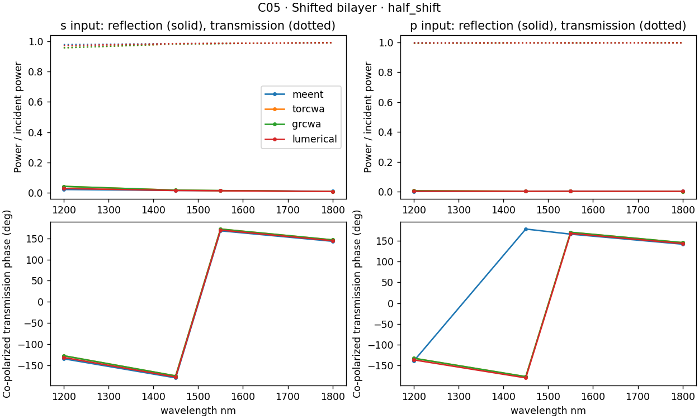

Geometry, additional spectra, diffraction orders and solver differences

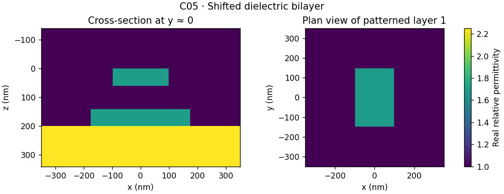

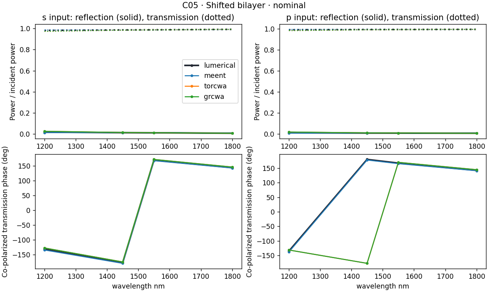

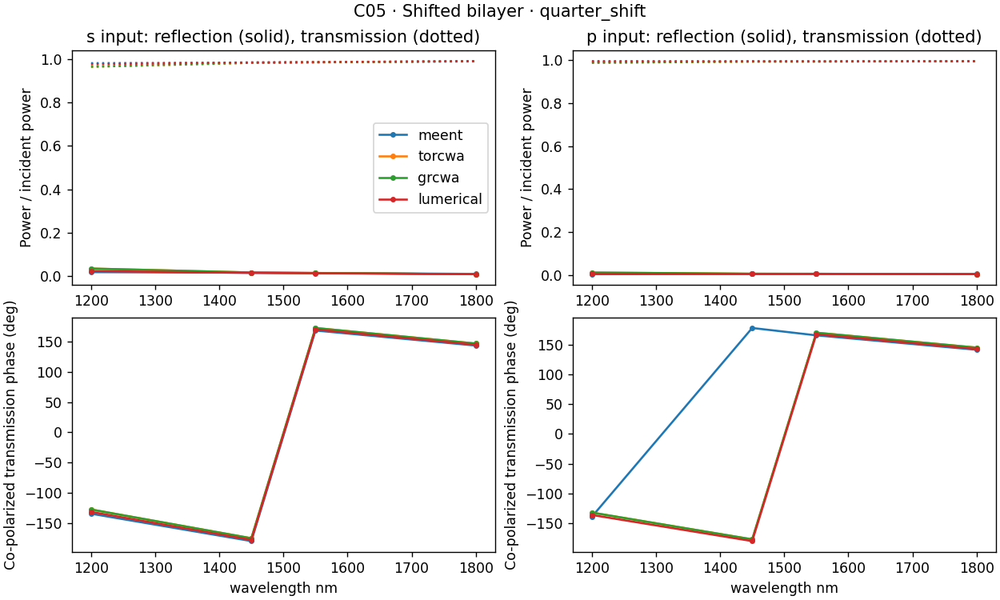

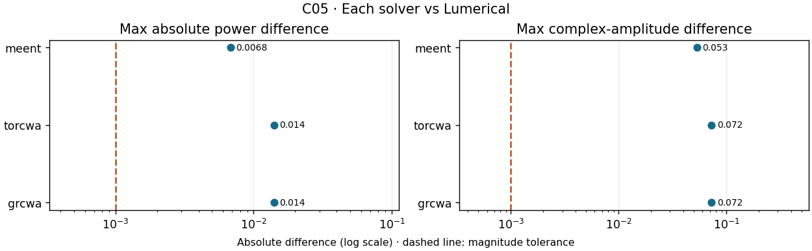

### C06

**Metagrating supercell**

[Notebook, physical model and applications](cases/C/C06/C06.ipynb) · [Diagnosis](PERIODIC_DIAGNOSIS.md#c06)

| Solver vs Lumerical | Matched points | Max ΔR | Max ΔT | Max ΔA | Max order ΔP | Max \|Δamplitude\| | Max phase Δ (deg) | Worst amplitude point | Status |
| --- | --- | --- | --- | --- | --- | --- | --- | --- | --- |
| meent | 4/4 | 0.209 | 0.209 | 1.88e-13 | 0.664 | 1.11 | 179 | 1 | INCONCLUSIVE |
| torcwa | 4/4 | 0.186 | 0.186 | 2.19e-13 | 0.238 | 0.824 | 176 | 0 | INCONCLUSIVE |
| grcwa | 4/4 | 0.186 | 0.186 | 2.8e-13 | 0.238 | 0.824 | 176 | 0 | INCONCLUSIVE |

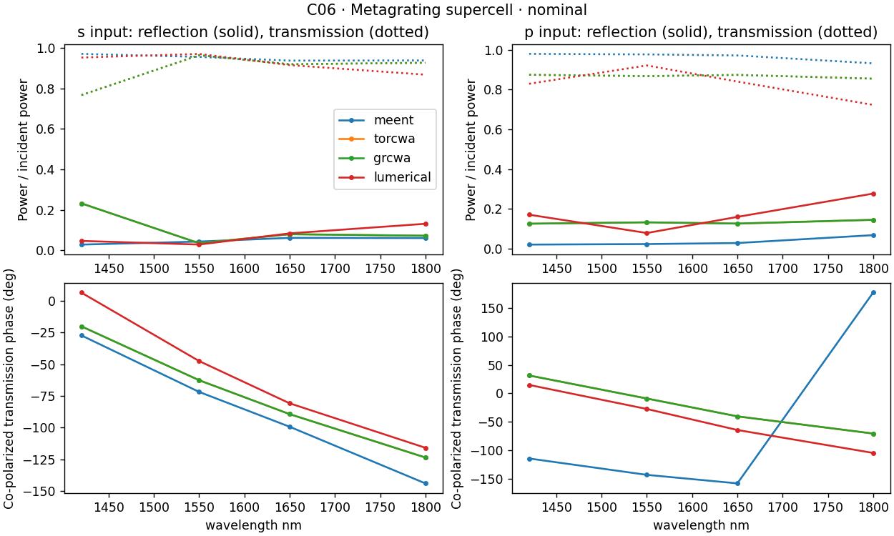

Geometry, additional spectra, diffraction orders and solver differences

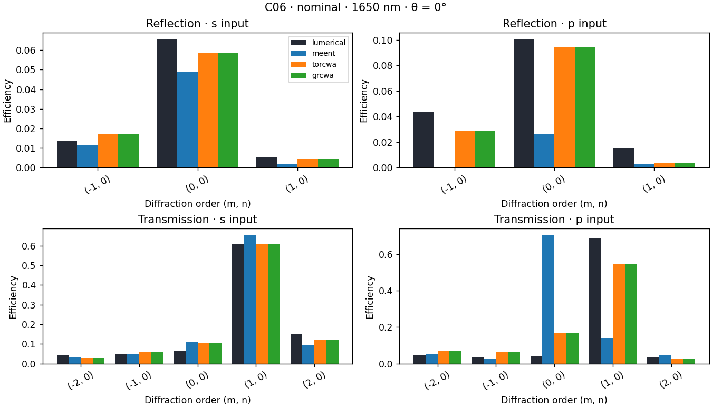

## Conclusion

**Planar validation.** 4/4 cases pass against Lumerical. The largest absolute power and complex-amplitude differences are 2.55e-13 and 1.59e-13.

**Periodic structures.** 12/12 cases are inconclusive under the reported settings. Agreement with Lumerical quantifies consistency for the sampled configurations. The periodic pass decision also requires convergence evidence from both solvers.

**Meent diagnosis.** Controlled changes to Meent's finite-order material matrices explain the main differences at discontinuous interfaces. The study also measures the effect of Lumerical's actual Fourier order, resonance sensitivity in C02, and the B06 half-mesh phase offset. [Experiments and case-by-case findings](PERIODIC_DIAGNOSIS.md).
