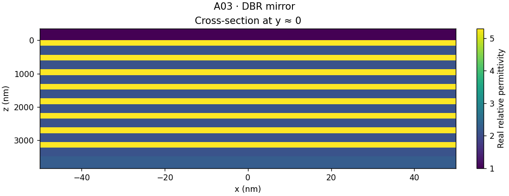
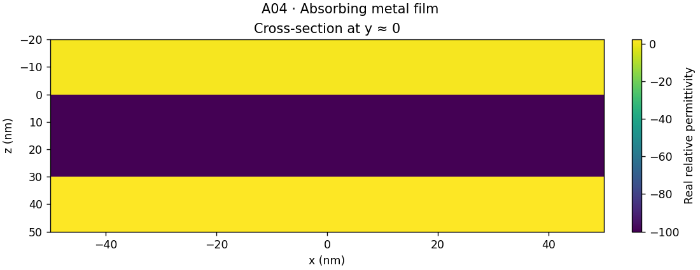
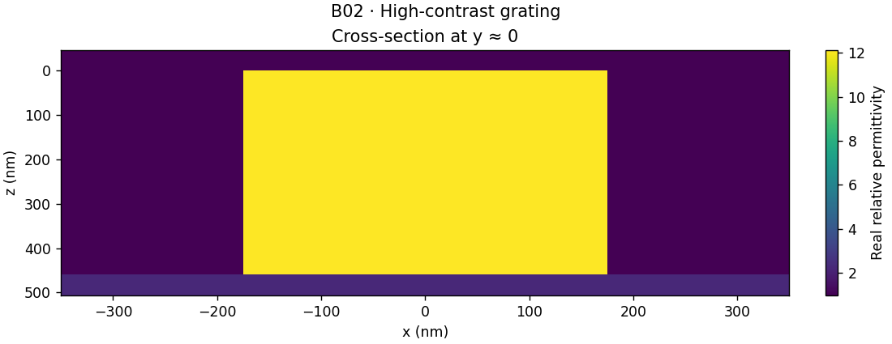
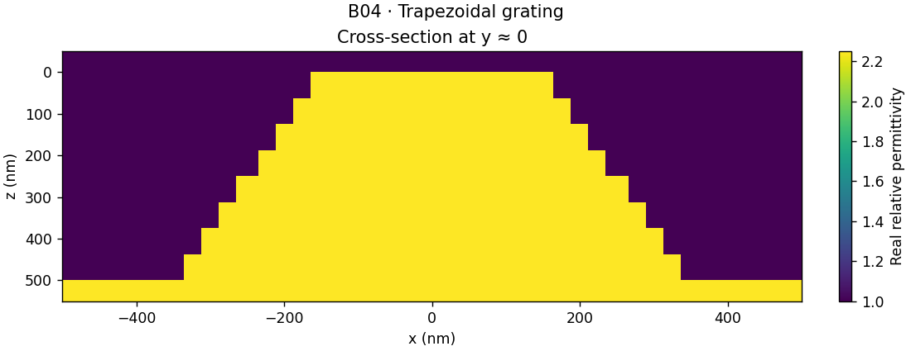
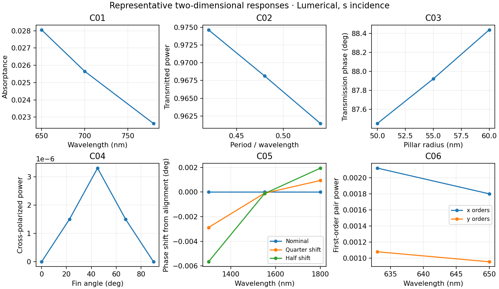
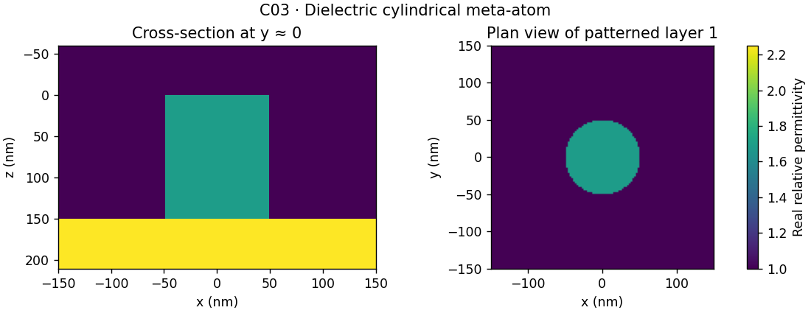
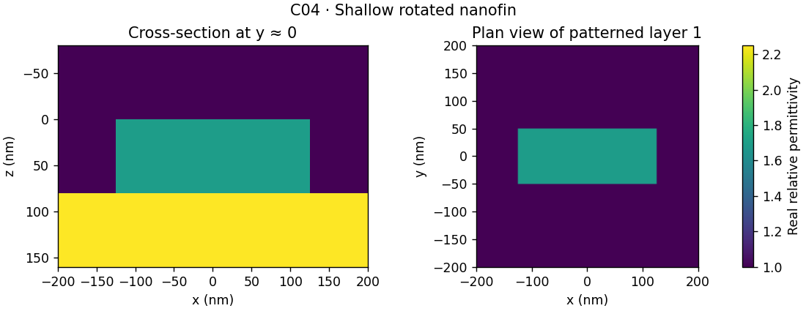
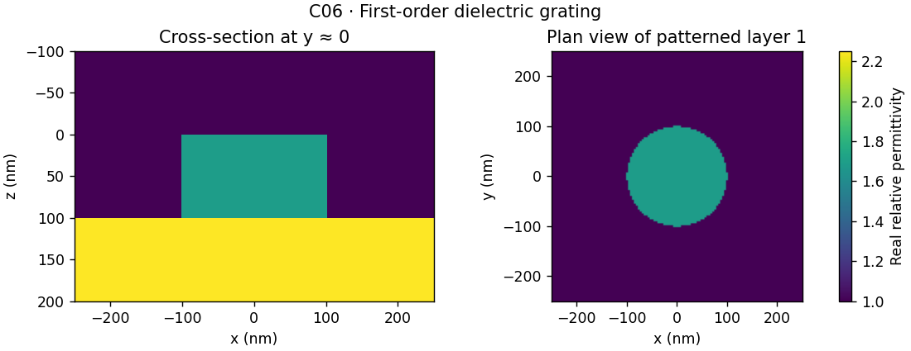

# RCWA Convergence Benchmark Against Lumerical

**16 cases · 80 excitation points · s and p incidence.** [Numerical data and refinement evidence](results/benchmark.json) · [Conclusion](#conclusion)

An agreement row uses only common points with matching propagating orders and convergence evidence from both solvers. Power-only pairs contribute power metrics. Full pairs also contribute complex amplitude and phase. A dash indicates missing paired evidence.

Class C requires all four solvers to certify the same observables at a point. The three comparisons against Lumerical are admitted together.

## Case overview

| Case | Optical structure | Points | Power pairs | Full pairs | Status |
| --- | --- | --- | --- | --- | --- |
| [A01](#a01) | Fresnel interface | 14 | 42/42 | 42/42 | Pass |
| [A02](#a02) | Antireflection film | 5 | 15/15 | 15/15 | Pass |
| [A03](#a03) | DBR mirror | 5 | 15/15 | 15/15 | Pass |
| [A04](#a04) | Absorbing metal film | 3 | 9/9 | 9/9 | Pass |
| [B01](#b01) | Binary dielectric grating | 4 | 12/12 | 12/12 | Pass |
| [B02](#b02) | High-contrast grating | 5 | 15/15 | 15/15 | Pass with Li adapters |
| [B03](#b03) | Conical incidence | 5 | 15/15 | 15/15 | Pass |
| [B04](#b04) | Trapezoidal grating | 4 | 12/12 | 12/12 | Pass |
| [B05](#b05) | Wire-grid polarizer | 3 | 9/9 | 9/9 | Pass with Li adapters |
| [B06](#b06) | Volume index grating | 7 | 21/21 | 21/21 | Pass |
| [C01](#c01) | Perforated absorbing film | 3 | 9/9 | 9/9 | Pass |
| [C02](#c02) | Perforated dielectric slab | 3 | 9/9 | 9/9 | Pass |
| [C03](#c03) | Dielectric cylindrical meta-atom | 3 | 9/9 | 9/9 | Pass |
| [C04](#c04) | Shallow rotated nanofin | 5 | 15/15 | 15/15 | Pass |
| [C05](#c05) | Shifted dielectric bilayer | 9 | 27/27 | 27/27 | Pass |
| [C06](#c06) | First-order dielectric grating | 2 | 6/6 | 6/6 | Pass |

The agreement plot uses the largest difference among the eligible pairs for each solver and case. The dashed line marks the comparison tolerance. The case tables identify where a Li adapter is used.

## Verification method

The study uses 80 published excitation points. For A, homogeneous planar layers require only the zero transverse harmonic. The independent Fresnel or multilayer solution checks the computed result at each point. The absolute power and amplitude tolerance is 1e-8.

For periodic structures, each active axis changes while the other settings are held fixed. The absolute refinement thresholds are 2.5e-4 in power and complex amplitude and 0.25° in eligible phase. The cross-solver thresholds are 1e-3 and 0.5°. Phase applies when both channel powers are at least 1e-4. The settings tables give within-solver changes for any remaining refinement limits. B uses solver-specific order, mesh, and slice refinements, including a 0.05° phase refinement at 920 nm for B03 Meent. [Ansys RCWA solver and Fourier settings](https://optics.ansys.com/hc/en-us/articles/12959229278611-RCWA-Solver-Simulation-Object)

For B02 and B05, Lumerical uses its 2D Li mode with permuted transverse coordinates. The direct 2D and 3D controls agreed within 7.7e-12 in complex amplitude at the tested settings. B04 uses the staircase geometry in a single 2D polygon. The B field phase uses the common transverse origin after removing the native half-sample shift on propagating nonzero orders.

The B02 and B05 follow-up uses two successive Fourier and raster refinements. [Li's Fourier factorization rules](https://opg.optica.org/josaa/abstract.cfm?uri=josaa-13-9-1870)

The B04 follow-up fixes the 128-slice staircase for the Fourier comparisons and uses the final reported Fourier basis for separate grid and slice tests. At 620 nm the slice study brackets the 128-slice production setting with 96 and 192 slices. Meent uses half-order 128 at that point with 108 and 148 as adjacent checks.

The representative two-dimensional cases use shallow, moderate-contrast structures. Each solver checks two successive Fourier refinements at fixed geometry resolution and doubles the transverse grid at fixed Fourier order. The production setting is the middle order in the first passing three-order window. C06 refines the x and y orders separately. Each checked setting must pass the energy, passivity, order-sum, and power normalization checks to 1e-6.

## A · Planar structures

### A01

**Fresnel interface**

[Notebook and physical model](cases/A/A01/A01.ipynb)

| Solver vs Lumerical | Power pairs | Power passes | Full pairs | Full passes | Max Δpower | Max complex-amplitude difference | Max phase Δ (deg) |
| --- | --- | --- | --- | --- | --- | --- | --- |
| meent | 14/14 | 14 | 14/14 | 14 | 9.59e-14 | 1.59e-13 | 1.24e-11 |
| torcwa | 14/14 | 14 | 14/14 | 14 | 9.6e-14 | 1.59e-13 | 1.24e-11 |
| grcwa | 14/14 | 14 | 14/14 | 14 | 9.63e-14 | 1.59e-13 | 1.24e-11 |

Settings, unresolved points and geometry

| Solver | Mode | Reported half-order | Grid | Slices | Power certified | Fully certified | Unresolved point (axis) | Max amplitude change in unresolved refinement | Solver error at point |
| --- | --- | --- | --- | --- | --- | --- | --- | --- | --- |
| meent | native | 0 | 2 | 1 | 14 | 14 | — | — | — |
| torcwa | native | 0 | 2 | 1 | 14 | 14 | — | — | — |
| grcwa | native | 0 | 2 | 1 | 14 | 14 | — | — | — |
| lumerical | native | 0 | 2 | 1 | 14 | 14 | — | — | — |

| Solver vs Lumerical | Power point indices | Full point indices |
| --- | --- | --- |
| meent | 0, 1, 2, 3, 4, 5, 6, 7, 8, 9, 10, 11, 12, 13 | 0, 1, 2, 3, 4, 5, 6, 7, 8, 9, 10, 11, 12, 13 |
| torcwa | 0, 1, 2, 3, 4, 5, 6, 7, 8, 9, 10, 11, 12, 13 | 0, 1, 2, 3, 4, 5, 6, 7, 8, 9, 10, 11, 12, 13 |
| grcwa | 0, 1, 2, 3, 4, 5, 6, 7, 8, 9, 10, 11, 12, 13 | 0, 1, 2, 3, 4, 5, 6, 7, 8, 9, 10, 11, 12, 13 |

| Point | Excitation |
| --- | --- |
| 0 | variant=nominal / theta_deg=0.0 |
| 1 | variant=nominal / theta_deg=30.0 |
| 2 | variant=nominal / theta_deg=40.0 |
| 3 | variant=nominal / theta_deg=45.0 |
| 4 | variant=nominal / theta_deg=56.309932474 |
| 5 | variant=nominal / theta_deg=65.0 |
| 6 | variant=nominal / theta_deg=80.0 |
| 7 | variant=reverse / epsilon_incident=2.25 / epsilon_exit=1.0 / theta_deg=0.0 |
| 8 | variant=reverse / epsilon_incident=2.25 / epsilon_exit=1.0 / theta_deg=30.0 |
| 9 | variant=reverse / epsilon_incident=2.25 / epsilon_exit=1.0 / theta_deg=40.0 |
| 10 | variant=reverse / epsilon_incident=2.25 / epsilon_exit=1.0 / theta_deg=45.0 |
| 11 | variant=reverse / epsilon_incident=2.25 / epsilon_exit=1.0 / theta_deg=56.309932474 |
| 12 | variant=reverse / epsilon_incident=2.25 / epsilon_exit=1.0 / theta_deg=65.0 |
| 13 | variant=reverse / epsilon_incident=2.25 / epsilon_exit=1.0 / theta_deg=80.0 |

### A02

**Antireflection film**

[Notebook and physical model](cases/A/A02/A02.ipynb)

| Solver vs Lumerical | Power pairs | Power passes | Full pairs | Full passes | Max Δpower | Max complex-amplitude difference | Max phase Δ (deg) |
| --- | --- | --- | --- | --- | --- | --- | --- |
| meent | 5/5 | 5 | 5/5 | 5 | 1.47e-14 | 7.9e-15 | 2.16e-12 |
| torcwa | 5/5 | 5 | 5/5 | 5 | 1.48e-14 | 8.05e-15 | 1.72e-12 |
| grcwa | 5/5 | 5 | 5/5 | 5 | 1.52e-14 | 8.49e-15 | 1.65e-12 |

Settings, unresolved points and geometry

| Solver | Mode | Reported half-order | Grid | Slices | Power certified | Fully certified | Unresolved point (axis) | Max amplitude change in unresolved refinement | Solver error at point |
| --- | --- | --- | --- | --- | --- | --- | --- | --- | --- |
| meent | native | 0 | 2 | 1 | 5 | 5 | — | — | — |
| torcwa | native | 0 | 2 | 1 | 5 | 5 | — | — | — |
| grcwa | native | 0 | 2 | 1 | 5 | 5 | — | — | — |
| lumerical | native | 0 | 2 | 1 | 5 | 5 | — | — | — |

| Solver vs Lumerical | Power point indices | Full point indices |
| --- | --- | --- |
| meent | 0, 1, 2, 3, 4 | 0, 1, 2, 3, 4 |
| torcwa | 0, 1, 2, 3, 4 | 0, 1, 2, 3, 4 |
| grcwa | 0, 1, 2, 3, 4 | 0, 1, 2, 3, 4 |

| Point | Excitation |
| --- | --- |
| 0 | variant=nominal / wavelength_nm=400.0 |
| 1 | variant=nominal / wavelength_nm=500.0 |
| 2 | variant=nominal / wavelength_nm=550.0 |
| 3 | variant=nominal / wavelength_nm=650.0 |
| 4 | variant=nominal / wavelength_nm=800.0 |

### A03

**DBR mirror**

[Notebook and physical model](cases/A/A03/A03.ipynb)

| Solver vs Lumerical | Power pairs | Power passes | Full pairs | Full passes | Max Δpower | Max complex-amplitude difference | Max phase Δ (deg) |
| --- | --- | --- | --- | --- | --- | --- | --- |
| meent | 5/5 | 5 | 5/5 | 5 | 2.55e-13 | 1.38e-13 | 1.95e-11 |
| torcwa | 5/5 | 5 | 5/5 | 5 | 2.51e-13 | 1.36e-13 | 1.92e-11 |
| grcwa | 5/5 | 5 | 5/5 | 5 | 2.53e-13 | 1.36e-13 | 1.92e-11 |

Settings, unresolved points and geometry

| Solver | Mode | Reported half-order | Grid | Slices | Power certified | Fully certified | Unresolved point (axis) | Max amplitude change in unresolved refinement | Solver error at point |
| --- | --- | --- | --- | --- | --- | --- | --- | --- | --- |
| meent | native | 0 | 2 | 1 | 5 | 5 | — | — | — |
| torcwa | native | 0 | 2 | 1 | 5 | 5 | — | — | — |
| grcwa | native | 0 | 2 | 1 | 5 | 5 | — | — | — |
| lumerical | native | 0 | 2 | 1 | 5 | 5 | — | — | — |

| Solver vs Lumerical | Power point indices | Full point indices |
| --- | --- | --- |
| meent | 0, 1, 2, 3, 4 | 0, 1, 2, 3, 4 |
| torcwa | 0, 1, 2, 3, 4 | 0, 1, 2, 3, 4 |
| grcwa | 0, 1, 2, 3, 4 | 0, 1, 2, 3, 4 |

| Point | Excitation |
| --- | --- |
| 0 | variant=nominal / wavelength_nm=1100.0 |
| 1 | variant=nominal / wavelength_nm=1300.0 |
| 2 | variant=nominal / wavelength_nm=1550.0 |
| 3 | variant=nominal / wavelength_nm=1800.0 |
| 4 | variant=nominal / wavelength_nm=2000.0 |

### A04

**Absorbing metal film**

[Notebook and physical model](cases/A/A04/A04.ipynb)

| Solver vs Lumerical | Power pairs | Power passes | Full pairs | Full passes | Max Δpower | Max complex-amplitude difference | Max phase Δ (deg) |
| --- | --- | --- | --- | --- | --- | --- | --- |
| meent | 3/3 | 3 | 3/3 | 3 | 1.44e-15 | 5.25e-15 | 3.04e-13 |
| torcwa | 3/3 | 3 | 3/3 | 3 | 1.33e-15 | 5.16e-15 | 2.98e-13 |
| grcwa | 3/3 | 3 | 3/3 | 3 | 1.55e-15 | 5.19e-15 | 2.99e-13 |

Settings, unresolved points and geometry

| Solver | Mode | Reported half-order | Grid | Slices | Power certified | Fully certified | Unresolved point (axis) | Max amplitude change in unresolved refinement | Solver error at point |
| --- | --- | --- | --- | --- | --- | --- | --- | --- | --- |
| meent | native | 0 | 2 | 1 | 3 | 3 | — | — | — |
| torcwa | native | 0 | 2 | 1 | 3 | 3 | — | — | — |
| grcwa | native | 0 | 2 | 1 | 3 | 3 | — | — | — |
| lumerical | native | 0 | 2 | 1 | 3 | 3 | — | — | — |

| Solver vs Lumerical | Power point indices | Full point indices |
| --- | --- | --- |
| meent | 0, 1, 2 | 0, 1, 2 |
| torcwa | 0, 1, 2 | 0, 1, 2 |
| grcwa | 0, 1, 2 | 0, 1, 2 |

| Point | Excitation |
| --- | --- |
| 0 | variant=nominal / wavelength_nm=1200.0 |
| 1 | variant=nominal / wavelength_nm=1500.0 |
| 2 | variant=nominal / wavelength_nm=1800.0 |

## B · One-dimensional periodic structures

### B01

**Binary dielectric grating**

[Notebook and physical model](cases/B/B01/B01.ipynb)

| Solver vs Lumerical | Power pairs | Power passes | Full pairs | Full passes | Max Δpower | Max complex-amplitude difference | Max phase Δ (deg) |
| --- | --- | --- | --- | --- | --- | --- | --- |
| meent | 4/4 | 4 | 4/4 | 4 | 0.000226 | 0.000816 | 0.159 |
| torcwa | 4/4 | 4 | 4/4 | 4 | 1.15e-05 | 3.59e-05 | 0.00638 |
| grcwa | 4/4 | 4 | 4/4 | 4 | 1.15e-05 | 3.59e-05 | 0.00638 |

Settings, unresolved points and geometry

| Solver | Mode | Reported half-order | Grid | Slices | Power certified | Fully certified | Unresolved point (axis) | Max amplitude change in unresolved refinement | Solver error at point |
| --- | --- | --- | --- | --- | --- | --- | --- | --- | --- |
| meent | native | 24 | 2048 | 1 | 4 | 4 | — | — | — |
| torcwa | native | 224 / 288 | 2048 | 1 | 4 | 4 | — | — | — |
| grcwa | native | 224 / 288 | 2048 | 1 | 4 | 4 | — | — | — |
| lumerical | 3D single ky sector | 224 / 288 | 2048 / 4096 | 1 | 4 | 4 | — | — | — |

| Solver vs Lumerical | Power point indices | Full point indices |
| --- | --- | --- |
| meent | 0, 1, 2, 3 | 0, 1, 2, 3 |
| torcwa | 0, 1, 2, 3 | 0, 1, 2, 3 |
| grcwa | 0, 1, 2, 3 | 0, 1, 2, 3 |

| Point | Excitation |
| --- | --- |
| 0 | variant=nominal / wavelength_nm=620.0 |
| 1 | variant=nominal / wavelength_nm=820.0 |
| 2 | variant=nominal / wavelength_nm=1050.0 |
| 3 | variant=nominal / wavelength_nm=1580.0 |

### B02

**High-contrast grating**

[Notebook and physical model](cases/B/B02/B02.ipynb)

| Solver vs Lumerical | Power pairs | Power passes | Full pairs | Full passes | Max Δpower | Max complex-amplitude difference | Max phase Δ (deg) |
| --- | --- | --- | --- | --- | --- | --- | --- |
| meent | 5/5 | 5 | 5/5 | 5 | 1.3e-06 | 2.28e-06 | 0.000159 |
| torcwa (Li adapter) | 5/5 | 5 | 5/5 | 5 | 5.96e-13 | 3.67e-12 | 3.51e-10 |
| grcwa (Li adapter) | 5/5 | 5 | 5/5 | 5 | 1.14e-11 | 1.26e-11 | 3.71e-10 |

Settings, unresolved points and geometry

| Solver | Mode | Reported half-order | Grid | Slices | Power certified | Fully certified | Unresolved point (axis) | Max amplitude change in unresolved refinement | Solver error at point |
| --- | --- | --- | --- | --- | --- | --- | --- | --- | --- |
| meent | native | 72 | 2048 | 1 | 5 | 5 | — | — | — |
| torcwa | 1D Li inverse rule | 72 | 2048 | 1 | 5 | 5 | — | — | — |
| grcwa | 1D Li inverse rule | 72 | 2048 | 1 | 5 | 5 | — | — | — |
| lumerical | 2D Li factorization | 72 | 2048 | 1 | 5 | 5 | — | — | — |

| Solver vs Lumerical | Power point indices | Full point indices |
| --- | --- | --- |
| meent | 0, 1, 2, 3, 4 | 0, 1, 2, 3, 4 |
| torcwa (Li adapter) | 0, 1, 2, 3, 4 | 0, 1, 2, 3, 4 |
| grcwa (Li adapter) | 0, 1, 2, 3, 4 | 0, 1, 2, 3, 4 |

| Point | Excitation |
| --- | --- |
| 0 | variant=nominal / wavelength_nm=1200.0 |
| 1 | variant=nominal / wavelength_nm=1400.0 |
| 2 | variant=nominal / wavelength_nm=1550.0 |
| 3 | variant=nominal / wavelength_nm=1650.0 |
| 4 | variant=nominal / wavelength_nm=1800.0 |

**Default open-source modes.** The primary rows use the Li adapter where indicated. The adapter replaces the material multiplication normal to the grating interface with the inverse Fourier rule and uses each library's eigensolver and scattering calculation. The default modes retain the following independently eligible comparisons.

| Solver vs Lumerical | Power pairs | Power passes | Full pairs | Full passes | Max Δpower | Max complex-amplitude difference | Max phase Δ (deg) |
| --- | --- | --- | --- | --- | --- | --- | --- |
| torcwa | 4/5 | 4 | 0/5 | 0 | 0.000574 | — | — |
| grcwa | 4/5 | 4 | 0/5 | 0 | 0.000574 | — | — |

Within-solver changes at higher default Fourier orders

| Solver | Point | Coarse half-order | Fine half-order | Grid | Max power change | Max amplitude change |
| --- | --- | --- | --- | --- | --- | --- |
| grcwa | 0 | 288 | 384 | 4096 | 0.000953 | 0.00115 |
| grcwa | 0 | 384 | 512 | 4096 | 0.000728 | 0.000878 |

### B03

**Conical incidence**

[Notebook and physical model](cases/B/B03/B03.ipynb)

| Solver vs Lumerical | Power pairs | Power passes | Full pairs | Full passes | Max Δpower | Max complex-amplitude difference | Max phase Δ (deg) |
| --- | --- | --- | --- | --- | --- | --- | --- |
| meent | 5/5 | 5 | 5/5 | 5 | 0.000316 | 0.000615 | 0.45 |
| torcwa | 5/5 | 5 | 5/5 | 5 | 1.03e-11 | 1.65e-11 | 8.02e-09 |
| grcwa | 5/5 | 5 | 5/5 | 5 | 2.67e-11 | 2.07e-11 | 3.86e-09 |

Settings, unresolved points and geometry

| Solver | Mode | Reported half-order | Grid | Slices | Power certified | Fully certified | Unresolved point (axis) | Max amplitude change in unresolved refinement | Solver error at point |
| --- | --- | --- | --- | --- | --- | --- | --- | --- | --- |
| meent | native | 16 / 24 / 54 | 2048 | 1 | 5 | 5 | — | — | — |
| torcwa | native | 168 / 224 | 2048 | 1 | 5 | 5 | — | — | — |
| grcwa | native | 168 / 224 | 2048 | 1 | 5 | 5 | — | — | — |
| lumerical | 3D single ky sector | 168 / 224 | 2048 | 1 | 5 | 5 | — | — | — |

| Solver vs Lumerical | Power point indices | Full point indices |
| --- | --- | --- |
| meent | 0, 1, 2, 3, 4 | 0, 1, 2, 3, 4 |
| torcwa | 0, 1, 2, 3, 4 | 0, 1, 2, 3, 4 |
| grcwa | 0, 1, 2, 3, 4 | 0, 1, 2, 3, 4 |

| Point | Excitation |
| --- | --- |
| 0 | variant=nominal / wavelength_nm=710.0 |
| 1 | variant=nominal / wavelength_nm=920.0 |
| 2 | variant=nominal / wavelength_nm=1180.0 |
| 3 | variant=nominal / wavelength_nm=1520.0 |
| 4 | variant=nominal / wavelength_nm=1800.0 |

### B04

**Trapezoidal grating**

[Notebook and physical model](cases/B/B04/B04.ipynb)

| Solver vs Lumerical | Power pairs | Power passes | Full pairs | Full passes | Max Δpower | Max complex-amplitude difference | Max phase Δ (deg) |
| --- | --- | --- | --- | --- | --- | --- | --- |
| meent | 4/4 | 4 | 4/4 | 4 | 0.000325 | 0.00094 | 0.375 |
| torcwa | 4/4 | 4 | 4/4 | 4 | 1.27e-05 | 0.000154 | 0.0244 |
| grcwa | 4/4 | 4 | 4/4 | 4 | 1.27e-05 | 0.000154 | 0.0244 |

Settings, unresolved points and geometry

| Solver | Mode | Reported half-order | Grid | Slices | Power certified | Fully certified | Unresolved point (axis) | Max amplitude change in unresolved refinement | Solver error at point |
| --- | --- | --- | --- | --- | --- | --- | --- | --- | --- |
| meent | native | 54 / 81 / 108 / 128 | 5120 | 32 / 128 | 4 | 4 | — | — | — |
| torcwa | native | 108 / 148 | 5120 | 128 | 4 | 4 | — | — | — |
| grcwa | native | 108 / 148 | 5120 | 128 | 4 | 4 | — | — | — |
| lumerical | 2D staircase polygon | 108 / 148 | 5120 | 32 / 128 | 4 | 4 | — | — | — |

| Solver vs Lumerical | Power point indices | Full point indices |
| --- | --- | --- |
| meent | 0, 1, 2, 3 | 0, 1, 2, 3 |
| torcwa | 0, 1, 2, 3 | 0, 1, 2, 3 |
| grcwa | 0, 1, 2, 3 | 0, 1, 2, 3 |

| Point | Excitation |
| --- | --- |
| 0 | variant=nominal / wavelength_nm=620.0 |
| 1 | variant=nominal / wavelength_nm=820.0 |
| 2 | variant=nominal / wavelength_nm=1050.0 |
| 3 | variant=nominal / wavelength_nm=1550.0 |

**Slice refinement at 620 nm.** Each change uses a fixed Fourier half-order of 148 and a fixed transverse grid. The production setting is 128 slices and is checked in both directions.

| Solver | Amplitude change from 64 to 128 slices | Largest change across 96, 128, and 192 slices |
| --- | --- | --- |
| torcwa | 0.000272 | 8.65e-05 |
| grcwa | 0.000272 | 8.65e-05 |
| lumerical | 0.000272 | 8.8e-05 |

### B05

**Wire-grid polarizer**

[Notebook and physical model](cases/B/B05/B05.ipynb)

| Solver vs Lumerical | Power pairs | Power passes | Full pairs | Full passes | Max Δpower | Max complex-amplitude difference | Max phase Δ (deg) |
| --- | --- | --- | --- | --- | --- | --- | --- |
| meent | 3/3 | 3 | 3/3 | 3 | 4.35e-06 | 2.47e-06 | 0.000384 |
| torcwa (Li adapter) | 3/3 | 3 | 3/3 | 3 | 1.57e-11 | 1.26e-11 | 7.4e-10 |
| grcwa (Li adapter) | 3/3 | 3 | 3/3 | 3 | 3.03e-11 | 3.22e-11 | 1.86e-09 |

Settings, unresolved points and geometry

| Solver | Mode | Reported half-order | Grid | Slices | Power certified | Fully certified | Unresolved point (axis) | Max amplitude change in unresolved refinement | Solver error at point |
| --- | --- | --- | --- | --- | --- | --- | --- | --- | --- |
| meent | native | 96 | 2048 | 1 | 3 | 3 | — | — | — |
| torcwa | 1D Li inverse rule | 96 | 2048 | 1 | 3 | 3 | — | — | — |
| grcwa | 1D Li inverse rule | 96 | 2048 | 1 | 3 | 3 | — | — | — |
| lumerical | 2D Li factorization | 96 | 2048 | 1 | 3 | 3 | — | — | — |

| Solver vs Lumerical | Power point indices | Full point indices |
| --- | --- | --- |
| meent | 0, 1, 2 | 0, 1, 2 |
| torcwa (Li adapter) | 0, 1, 2 | 0, 1, 2 |
| grcwa (Li adapter) | 0, 1, 2 | 0, 1, 2 |

| Point | Excitation |
| --- | --- |
| 0 | variant=nominal / wavelength_nm=1200.0 |
| 1 | variant=nominal / wavelength_nm=1500.0 |
| 2 | variant=nominal / wavelength_nm=1800.0 |

**Default open-source modes.** The primary rows use the Li adapter where indicated. The adapter replaces the material multiplication normal to the grating interface with the inverse Fourier rule and uses each library's eigensolver and scattering calculation. The default modes retain the following independently eligible comparisons.

| Solver vs Lumerical | Power pairs | Power passes | Full pairs | Full passes | Max Δpower | Max complex-amplitude difference | Max phase Δ (deg) |
| --- | --- | --- | --- | --- | --- | --- | --- |
| torcwa | 0/3 | 0 | 0/3 | 0 | — | — | — |
| grcwa | 0/3 | 0 | 0/3 | 0 | — | — | — |

Within-solver changes at higher default Fourier orders

| Solver | Point | Coarse half-order | Fine half-order | Grid | Max power change | Max amplitude change |
| --- | --- | --- | --- | --- | --- | --- |
| torcwa | 0 | 288 | 384 | 16384 | 0.0097 | 0.00532 |
| torcwa | 0 | 384 | 512 | 16384 | 0.00862 | 0.00585 |

### B06

**Volume index grating**

[Notebook and physical model](cases/B/B06/B06.ipynb)

| Solver vs Lumerical | Power pairs | Power passes | Full pairs | Full passes | Max Δpower | Max complex-amplitude difference | Max phase Δ (deg) |
| --- | --- | --- | --- | --- | --- | --- | --- |
| meent | 7/7 | 7 | 7/7 | 7 | 5.95e-05 | 7.79e-05 | 0.00534 |
| torcwa | 7/7 | 7 | 7/7 | 7 | 8.35e-14 | 2.08e-13 | 2.12e-11 |
| grcwa | 7/7 | 7 | 7/7 | 7 | 8.71e-14 | 1.08e-11 | 2.49e-11 |

Settings, unresolved points and geometry

| Solver | Mode | Reported half-order | Grid | Slices | Power certified | Fully certified | Unresolved point (axis) | Max amplitude change in unresolved refinement | Solver error at point |
| --- | --- | --- | --- | --- | --- | --- | --- | --- | --- |
| meent | native | 8 | 128 / 256 | 1 | 7 | 7 | — | — | — |
| torcwa | native | 8 | 128 | 1 | 7 | 7 | — | — | — |
| grcwa | native | 8 | 128 | 1 | 7 | 7 | — | — | — |
| lumerical | 3D single ky sector | 8 | 128 | 1 | 7 | 7 | — | — | — |

| Solver vs Lumerical | Power point indices | Full point indices |
| --- | --- | --- |
| meent | 0, 1, 2, 3, 4, 5, 6 | 0, 1, 2, 3, 4, 5, 6 |
| torcwa | 0, 1, 2, 3, 4, 5, 6 | 0, 1, 2, 3, 4, 5, 6 |
| grcwa | 0, 1, 2, 3, 4, 5, 6 | 0, 1, 2, 3, 4, 5, 6 |

| Point | Excitation |
| --- | --- |
| 0 | variant=nominal / theta_deg=8.0 |
| 1 | variant=nominal / theta_deg=10.0 |
| 2 | variant=nominal / theta_deg=11.5 |
| 3 | variant=nominal / theta_deg=12.0 |
| 4 | variant=nominal / theta_deg=12.5 |
| 5 | variant=nominal / theta_deg=14.0 |
| 6 | variant=nominal / theta_deg=16.0 |

## C · Two-dimensional periodic structures

### C01

**Perforated absorbing film**

[Notebook and physical model](cases/C/C01/C01.ipynb)

| Solver vs Lumerical | Power pairs | Power passes | Full pairs | Full passes | Max Δpower | Max complex-amplitude difference | Max phase Δ (deg) |
| --- | --- | --- | --- | --- | --- | --- | --- |
| meent | 3/3 | 3 | 3/3 | 3 | 0.00017 | 0.000493 | 0.137 |
| torcwa | 3/3 | 3 | 3/3 | 3 | 2.49e-06 | 1.35e-05 | 0.00378 |
| grcwa | 3/3 | 3 | 3/3 | 3 | 2.49e-06 | 1.35e-05 | 0.00378 |

Settings, unresolved points and geometry

| Solver | Mode | Reported half-order | Grid | Slices | Power certified | Fully certified | Unresolved point (axis) | Max amplitude change in unresolved refinement | Solver error at point |
| --- | --- | --- | --- | --- | --- | --- | --- | --- | --- |
| meent | native | 7 | 480 | 1 | 3 | 3 | — | — | — |
| torcwa | native | 7 | 480 | 1 | 3 | 3 | — | — | — |
| grcwa | native | 7 | 480 | 1 | 3 | 3 | — | — | — |
| lumerical | 3D rectangular CAD | 7 | 480 | 1 | 3 | 3 | — | — | — |

| Solver vs Lumerical | Power point indices | Full point indices |
| --- | --- | --- |
| meent | 0, 1, 2 | 0, 1, 2 |
| torcwa | 0, 1, 2 | 0, 1, 2 |
| grcwa | 0, 1, 2 | 0, 1, 2 |

Certified settings at compared points (half-order / grid)

| Point | Common evidence | Meent | torcwa | grcwa | Lumerical |
| --- | --- | --- | --- | --- | --- |
| 0 | Full | 7 / 480 | 7 / 480 | 7 / 480 | 7 / 480 |
| 1 | Full | 7 / 480 | 7 / 480 | 7 / 480 | 7 / 480 |
| 2 | Full | 7 / 480 | 7 / 480 | 7 / 480 | 7 / 480 |

| Point | Excitation |
| --- | --- |
| 0 | variant=nominal / wavelength_nm=650.0 |
| 1 | variant=nominal / wavelength_nm=700.0 |
| 2 | variant=nominal / wavelength_nm=780.0 |

### C02

**Perforated dielectric slab**

[Notebook and physical model](cases/C/C02/C02.ipynb)

| Solver vs Lumerical | Power pairs | Power passes | Full pairs | Full passes | Max Δpower | Max complex-amplitude difference | Max phase Δ (deg) |
| --- | --- | --- | --- | --- | --- | --- | --- |
| meent | 3/3 | 3 | 3/3 | 3 | 0.000275 | 0.00076 | 0.0437 |
| torcwa | 3/3 | 3 | 3/3 | 3 | 6e-06 | 1.65e-05 | 0.00095 |
| grcwa | 3/3 | 3 | 3/3 | 3 | 6e-06 | 1.65e-05 | 0.00095 |

Settings, unresolved points and geometry

| Solver | Mode | Reported half-order | Grid | Slices | Power certified | Fully certified | Unresolved point (axis) | Max amplitude change in unresolved refinement | Solver error at point |
| --- | --- | --- | --- | --- | --- | --- | --- | --- | --- |
| meent | native | 7 | 480 | 1 | 3 | 3 | — | — | — |
| torcwa | native | 7 | 480 | 1 | 3 | 3 | — | — | — |
| grcwa | native | 7 | 480 | 1 | 3 | 3 | — | — | — |
| lumerical | 3D rectangular CAD | 7 | 480 | 1 | 3 | 3 | — | — | — |

| Solver vs Lumerical | Power point indices | Full point indices |
| --- | --- | --- |
| meent | 0, 1, 2 | 0, 1, 2 |
| torcwa | 0, 1, 2 | 0, 1, 2 |
| grcwa | 0, 1, 2 | 0, 1, 2 |

Certified settings at compared points (half-order / grid)

| Point | Common evidence | Meent | torcwa | grcwa | Lumerical |
| --- | --- | --- | --- | --- | --- |
| 0 | Full | 7 / 480 | 7 / 480 | 7 / 480 | 7 / 480 |
| 1 | Full | 7 / 480 | 7 / 480 | 7 / 480 | 7 / 480 |
| 2 | Full | 7 / 480 | 7 / 480 | 7 / 480 | 7 / 480 |

| Point | Excitation |
| --- | --- |
| 0 | variant=nominal / normalized_frequency=0.42 |
| 1 | variant=nominal / normalized_frequency=0.48 |
| 2 | variant=nominal / normalized_frequency=0.54 |

### C03

**Dielectric cylindrical meta-atom**

[Notebook and physical model](cases/C/C03/C03.ipynb)

| Solver vs Lumerical | Power pairs | Power passes | Full pairs | Full passes | Max Δpower | Max complex-amplitude difference | Max phase Δ (deg) |
| --- | --- | --- | --- | --- | --- | --- | --- |
| meent | 3/3 | 3 | 3/3 | 3 | 0.000175 | 0.000837 | 0.0982 |
| torcwa | 3/3 | 3 | 3/3 | 3 | 6.31e-06 | 2.97e-05 | 0.00335 |
| grcwa | 3/3 | 3 | 3/3 | 3 | 6.31e-06 | 2.97e-05 | 0.00335 |

Settings, unresolved points and geometry

| Solver | Mode | Reported half-order | Grid | Slices | Power certified | Fully certified | Unresolved point (axis) | Max amplitude change in unresolved refinement | Solver error at point |
| --- | --- | --- | --- | --- | --- | --- | --- | --- | --- |
| meent | native | 11 | 480 | 1 | 3 | 3 | — | — | — |
| torcwa | native | 11 | 480 | 1 | 3 | 3 | — | — | — |
| grcwa | native | 11 | 480 | 1 | 3 | 3 | — | — | — |
| lumerical | 3D rectangular CAD | 11 | 480 | 1 | 3 | 3 | — | — | — |

| Solver vs Lumerical | Power point indices | Full point indices |
| --- | --- | --- |
| meent | 0, 1, 2 | 0, 1, 2 |
| torcwa | 0, 1, 2 | 0, 1, 2 |
| grcwa | 0, 1, 2 | 0, 1, 2 |

Certified settings at compared points (half-order / grid)

| Point | Common evidence | Meent | torcwa | grcwa | Lumerical |
| --- | --- | --- | --- | --- | --- |
| 0 | Full | 11 / 480 | 11 / 480 | 11 / 480 | 11 / 480 |
| 1 | Full | 11 / 480 | 11 / 480 | 11 / 480 | 11 / 480 |
| 2 | Full | 11 / 480 | 11 / 480 | 11 / 480 | 11 / 480 |

| Point | Excitation |
| --- | --- |
| 0 | variant=nominal / radius_nm=50.0 |
| 1 | variant=nominal / radius_nm=55.0 |
| 2 | variant=nominal / radius_nm=60.0 |

### C04

**Shallow rotated nanofin**

[Notebook and physical model](cases/C/C04/C04.ipynb)

| Solver vs Lumerical | Power pairs | Power passes | Full pairs | Full passes | Max Δpower | Max complex-amplitude difference | Max phase Δ (deg) |
| --- | --- | --- | --- | --- | --- | --- | --- |
| meent | 5/5 | 5 | 5/5 | 5 | 0.000217 | 0.000958 | 0.136 |
| torcwa | 5/5 | 5 | 5/5 | 5 | 1.22e-05 | 5.45e-05 | 0.00786 |
| grcwa | 5/5 | 5 | 5/5 | 5 | 1.22e-05 | 5.45e-05 | 0.00786 |

Settings, unresolved points and geometry

| Solver | Mode | Reported half-order | Grid | Slices | Power certified | Fully certified | Unresolved point (axis) | Max amplitude change in unresolved refinement | Solver error at point |
| --- | --- | --- | --- | --- | --- | --- | --- | --- | --- |
| meent | native | 7 | 768 | 1 | 5 | 5 | — | — | — |
| torcwa | native | 7 / 9 | 768 | 1 | 5 | 5 | — | — | — |
| grcwa | native | 7 / 9 | 768 | 1 | 5 | 5 | — | — | — |
| lumerical | 3D rectangular CAD | 7 / 9 | 768 | 1 | 5 | 5 | — | — | — |

| Solver vs Lumerical | Power point indices | Full point indices |
| --- | --- | --- |
| meent | 0, 1, 2, 3, 4 | 0, 1, 2, 3, 4 |
| torcwa | 0, 1, 2, 3, 4 | 0, 1, 2, 3, 4 |
| grcwa | 0, 1, 2, 3, 4 | 0, 1, 2, 3, 4 |

Certified settings at compared points (half-order / grid)

| Point | Common evidence | Meent | torcwa | grcwa | Lumerical |
| --- | --- | --- | --- | --- | --- |
| 0 | Full | 7 / 768 | 9 / 768 | 9 / 768 | 9 / 768 |
| 1 | Full | 7 / 768 | 7 / 768 | 7 / 768 | 7 / 768 |
| 2 | Full | 7 / 768 | 7 / 768 | 7 / 768 | 7 / 768 |
| 3 | Full | 7 / 768 | 7 / 768 | 7 / 768 | 7 / 768 |
| 4 | Full | 7 / 768 | 9 / 768 | 9 / 768 | 9 / 768 |

| Point | Excitation |
| --- | --- |
| 0 | variant=nominal / rotation_deg=0.0 |
| 1 | variant=nominal / rotation_deg=22.5 |
| 2 | variant=nominal / rotation_deg=45.0 |
| 3 | variant=nominal / rotation_deg=67.5 |
| 4 | variant=nominal / rotation_deg=90.0 |

### C05

**Shifted dielectric bilayer**

[Notebook and physical model](cases/C/C05/C05.ipynb)

| Solver vs Lumerical | Power pairs | Power passes | Full pairs | Full passes | Max Δpower | Max complex-amplitude difference | Max phase Δ (deg) |
| --- | --- | --- | --- | --- | --- | --- | --- |
| meent | 9/9 | 9 | 9/9 | 9 | 0.000137 | 0.00058 | 0.0498 |
| torcwa | 9/9 | 9 | 9/9 | 9 | 3.47e-14 | 1.39e-13 | 1.92e-11 |
| grcwa | 9/9 | 9 | 9/9 | 9 | 4.94e-14 | 1.7e-13 | 4.69e-11 |

Settings, unresolved points and geometry

| Solver | Mode | Reported half-order | Grid | Slices | Power certified | Fully certified | Unresolved point (axis) | Max amplitude change in unresolved refinement | Solver error at point |
| --- | --- | --- | --- | --- | --- | --- | --- | --- | --- |
| meent | native | 7 | 448 | 1 | 9 | 9 | — | — | — |
| torcwa | native | 7 | 448 | 1 | 9 | 9 | — | — | — |
| grcwa | native | 7 | 448 | 1 | 9 | 9 | — | — | — |
| lumerical | 3D rectangular CAD | 7 | 448 | 1 | 9 | 9 | — | — | — |

| Solver vs Lumerical | Power point indices | Full point indices |
| --- | --- | --- |
| meent | 0, 1, 2, 3, 4, 5, 6, 7, 8 | 0, 1, 2, 3, 4, 5, 6, 7, 8 |
| torcwa | 0, 1, 2, 3, 4, 5, 6, 7, 8 | 0, 1, 2, 3, 4, 5, 6, 7, 8 |
| grcwa | 0, 1, 2, 3, 4, 5, 6, 7, 8 | 0, 1, 2, 3, 4, 5, 6, 7, 8 |

Certified settings at compared points (half-order / grid)

| Point | Common evidence | Meent | torcwa | grcwa | Lumerical |
| --- | --- | --- | --- | --- | --- |
| 0 | Full | 7 / 448 | 7 / 448 | 7 / 448 | 7 / 448 |
| 1 | Full | 7 / 448 | 7 / 448 | 7 / 448 | 7 / 448 |
| 2 | Full | 7 / 448 | 7 / 448 | 7 / 448 | 7 / 448 |
| 3 | Full | 7 / 448 | 7 / 448 | 7 / 448 | 7 / 448 |
| 4 | Full | 7 / 448 | 7 / 448 | 7 / 448 | 7 / 448 |
| 5 | Full | 7 / 448 | 7 / 448 | 7 / 448 | 7 / 448 |
| 6 | Full | 7 / 448 | 7 / 448 | 7 / 448 | 7 / 448 |
| 7 | Full | 7 / 448 | 7 / 448 | 7 / 448 | 7 / 448 |
| 8 | Full | 7 / 448 | 7 / 448 | 7 / 448 | 7 / 448 |

| Point | Excitation |
| --- | --- |
| 0 | variant=nominal / wavelength_nm=1300.0 |
| 1 | variant=nominal / wavelength_nm=1550.0 |
| 2 | variant=nominal / wavelength_nm=1800.0 |
| 3 | variant=quarter_shift / shift_nm=175 / wavelength_nm=1300.0 |
| 4 | variant=quarter_shift / shift_nm=175 / wavelength_nm=1550.0 |
| 5 | variant=quarter_shift / shift_nm=175 / wavelength_nm=1800.0 |
| 6 | variant=half_shift / shift_nm=350 / wavelength_nm=1300.0 |
| 7 | variant=half_shift / shift_nm=350 / wavelength_nm=1550.0 |
| 8 | variant=half_shift / shift_nm=350 / wavelength_nm=1800.0 |

### C06

**First-order dielectric grating**

[Notebook and physical model](cases/C/C06/C06.ipynb)

| Solver vs Lumerical | Power pairs | Power passes | Full pairs | Full passes | Max Δpower | Max complex-amplitude difference | Max phase Δ (deg) |
| --- | --- | --- | --- | --- | --- | --- | --- |
| meent | 2/2 | 2 | 2/2 | 2 | 0.000179 | 0.000731 | 0.353 |
| torcwa | 2/2 | 2 | 2/2 | 2 | 3.95e-07 | 0.000133 | 0.235 |
| grcwa | 2/2 | 2 | 2/2 | 2 | 3.95e-07 | 0.000133 | 0.235 |

Settings, unresolved points and geometry

| Solver | Mode | Reported half-order | Grid | Slices | Power certified | Fully certified | Unresolved point (axis) | Max amplitude change in unresolved refinement | Solver error at point |
| --- | --- | --- | --- | --- | --- | --- | --- | --- | --- |
| meent | native | 9 | 768 | 1 | 2 | 2 | — | — | — |
| torcwa | native | 9 | 768 | 1 | 2 | 2 | — | — | — |
| grcwa | native | 9 | 768 | 1 | 2 | 2 | — | — | — |
| lumerical | 3D rectangular CAD | 9 | 768 | 1 | 2 | 2 | — | — | — |

| Solver vs Lumerical | Power point indices | Full point indices |
| --- | --- | --- |
| meent | 0, 1 | 0, 1 |
| torcwa | 0, 1 | 0, 1 |
| grcwa | 0, 1 | 0, 1 |

Certified settings at compared points (half-order / grid)

| Point | Common evidence | Meent | torcwa | grcwa | Lumerical |
| --- | --- | --- | --- | --- | --- |
| 0 | Full | 9 / 768 | 9 / 768 | 9 / 768 | 9 / 768 |
| 1 | Full | 9 / 768 | 9 / 768 | 9 / 768 | 9 / 768 |

| Point | Excitation |
| --- | --- |
| 0 | variant=nominal / wavelength_nm=633.0 |
| 1 | variant=nominal / wavelength_nm=650.0 |

## Conclusion

| Group | Possible pairs | Power pairs | Power passes | Full pairs | Full passes |
| --- | --- | --- | --- | --- | --- |
| A | 81 | 81 | 81 | 81 | 81 |
| B | 84 | 84 | 84 | 84 | 84 |
| C | 75 | 75 | 75 | 75 | 75 |

Of 240 possible pairs, 240 qualify for power comparison and 240 qualify for the full comparison. 240 power pairs and 240 full pairs meet their agreement tolerances.

Cases passing every comparison with their original solver modes are A01, A02, A03, A04, B01, B03, B04, B06, C01, C02, C03, C04, C05, C06.

In class C, all four solvers qualify at 25/25 points for power and 25/25 points for power, complex amplitude, and phase together.

Cases passing every comparison with the indicated Li adapters are B02, B05.
