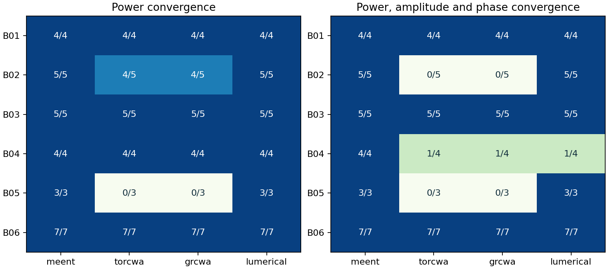

# Class B convergence benchmark

Each solver is refined independently at all 28 published class B excitations. Lumerical is the comparison reference. Maxima below use only points with the corresponding convergence evidence in both solvers. A dash denotes unavailable paired evidence.



## Comparisons against Lumerical

| Case | Solver | Power pairs | Full pairs | Max Δpower | Max \|Δamplitude\| | Max Δphase (deg) | Power passes | Full passes |
| --- | --- | --- | --- | --- | --- | --- | --- | --- |
| B01 | meent | 4/4 | 4/4 | 0.000226 | 0.000816 | 0.159 | 4 | 4 |
| B01 | torcwa | 4/4 | 4/4 | 1.15e-05 | 3.59e-05 | 0.00638 | 4 | 4 |
| B01 | grcwa | 4/4 | 4/4 | 1.15e-05 | 3.59e-05 | 0.00638 | 4 | 4 |
| B02 | meent | 5/5 | 5/5 | 1.37e-06 | 2.42e-06 | 0.000163 | 5 | 5 |
| B02 | torcwa | 4/5 | 0/5 | 0.000539 | — | — | 4 | 0 |
| B02 | grcwa | 4/5 | 0/5 | 0.000539 | — | — | 4 | 0 |
| B03 | meent | 5/5 | 5/5 | 0.000316 | 0.000615 | 0.45 | 5 | 5 |
| B03 | torcwa | 5/5 | 5/5 | 1.03e-11 | 1.65e-11 | 8.02e-09 | 5 | 5 |
| B03 | grcwa | 5/5 | 5/5 | 2.67e-11 | 2.07e-11 | 3.86e-09 | 5 | 5 |
| B04 | meent | 4/4 | 1/4 | 0.000449 | 0.000862 | 0.228 | 4 | 1 |
| B04 | torcwa | 4/4 | 1/4 | 1.27e-05 | 0.000154 | 0.0244 | 4 | 1 |
| B04 | grcwa | 4/4 | 1/4 | 1.27e-05 | 0.000154 | 0.0244 | 4 | 1 |
| B05 | meent | 3/3 | 3/3 | 3.06e-06 | 2.04e-06 | 0.000297 | 3 | 3 |
| B05 | torcwa | 0/3 | 0/3 | — | — | — | 0 | 0 |
| B05 | grcwa | 0/3 | 0/3 | — | — | — | 0 | 0 |
| B06 | meent | 7/7 | 7/7 | 5.95e-05 | 7.79e-05 | 0.00534 | 7 | 7 |
| B06 | torcwa | 7/7 | 7/7 | 8.35e-14 | 2.08e-13 | 2.12e-11 | 7 | 7 |
| B06 | grcwa | 7/7 | 7/7 | 8.71e-14 | 1.08e-11 | 2.49e-11 | 7 | 7 |

## Settings and unresolved axes

| Case | Solver | Mode | Power converged | Fully converged | Order / grid / slices | Unresolved axes | Largest unresolved amplitude change |
| --- | --- | --- | --- | --- | --- | --- | --- |
| B01 | meent | native | 4 | 4 | 24 / 2048 | — | — |
| B01 | torcwa | native | 4 | 4 | 224, 288 / 2048 | — | — |
| B01 | grcwa | native | 4 | 4 | 224, 288 / 2048 | — | — |
| B01 | lumerical | 3D single ky sector | 4 | 4 | 224, 288 / 2048, 4096 | — | — |
| B02 | meent | native | 5 | 5 | 24, 36 / 2048 | — | — |
| B02 | torcwa | native | 4 | 0 | 288 / 2048, 4096 | order | 0.0013 |
| B02 | grcwa | native | 4 | 0 | 288 / 2048, 4096 | order | 0.0013 |
| B02 | lumerical | 2D Li factorization | 5 | 5 | 24, 36 / 2048 | — | — |
| B03 | meent | native | 5 | 5 | 16, 24, 54 / 2048 | — | — |
| B03 | torcwa | native | 5 | 5 | 168, 224 / 2048 | — | — |
| B03 | grcwa | native | 5 | 5 | 168, 224 / 2048 | — | — |
| B03 | lumerical | 3D single ky sector | 5 | 5 | 168, 224 / 2048 | — | — |
| B04 | meent | native | 4 | 4 | 54, 81, 108 / 5120 / 32, 128 | — | — |
| B04 | torcwa | native | 4 | 1 | 108 / 5120 / 128 | order | 0.000328 |
| B04 | grcwa | native | 4 | 1 | 108 / 5120 / 128 | order | 0.000328 |
| B04 | lumerical | 2D staircase polygon | 4 | 1 | 108 / 5120 / 32, 128 | order | 0.000328 |
| B05 | meent | native | 3 | 3 | 54 / 2048 | — | — |
| B05 | torcwa | native | 0 | 0 | 288 / 16384 | order | 0.00199 |
| B05 | grcwa | native | 0 | 0 | 288 / 16384 | order | 0.00199 |
| B05 | lumerical | 2D Li factorization | 3 | 3 | 54 / 2048 | — | — |
| B06 | meent | native | 7 | 7 | 8 / 128, 256 | — | — |
| B06 | torcwa | native | 7 | 7 | 8 / 128 | — | — |
| B06 | grcwa | native | 7 | 7 | 8 / 128 | — | — |
| B06 | lumerical | 3D single ky sector | 7 | 7 | 8 / 128 | — | — |

## Software

| Solver | Version | Device | Lumerical build or PyTorch version |
| --- | --- | --- | --- |
| meent | 0.13.2 | CPU | — |
| torcwa | 0.1.4.2 | NVIDIA GeForce RTX 4060 Laptop GPU | 2.8.0+cu128 |
| grcwa | 0.1.2 | CPU | — |
| lumerical | v252 | CPU | 8.34.4175 |

## Method

Each active axis is checked against its preceding setting while all other axes are fixed. The absolute refinement tolerance is 2.5e-4 for power and complex amplitude, and 0.25° for eligible phase channels. The comparison tolerances are 1e-3 and 0.5°. Lumerical's actual native order lists are checked. Lumerical uses native 2D Li factorization for B02 and B05 in permuted transverse coordinates. In controls at 1200 nm and M = 16 and 36, the rotated model with Li disabled agreed with the direct 3D model within 7.7e-12 in complex amplitude. B04 uses the direct 2D numerical mode with a polygon that preserves the staircase geometry of each slice setting. At 620 nm this representation matched grcwa within 2.8e-13 in complex amplitude in controls with 16 and 32 slices. B01, B03, and B06 use the 3D solver with one coupled y sector. For propagating nonzero orders the field phase is aligned using the native mesh spacing and the predicted half-sample shift. The spacing is verified from the reported x mesh or, for the mirror-symmetric B04 polygon, from the phase relation of opposite orders. Powers are preserved. The original quick benchmark keeps its published settings. [Ansys RCWA solver and Li factorization](https://optics.ansys.com/hc/en-us/articles/12959229278611-RCWA-Solver-Simulation-Object)

```powershell
& .\.venv\Scripts\python.exe scripts\converge_b.py
```

The script resumes from completed point records in `.runs/b-convergence`. Pass `--cache` with a different directory to run from scratch.

[Numerical dataset](results/benchmark.json) · [Reproduction script](scripts/converge_b.py) · [B06 phase diagnosis](PERIODIC_DIAGNOSIS.md#b06)

The B03 Meent point at 920 nm received an additional independent phase refinement to 0.05°. The maximum cross-solver phase change at that point went from 0.557° to 0.450°. The table uses the finer result.

## Conclusion

Both solvers satisfy the complete refinement criteria in 59 of 84 possible open-source/Lumerical point comparisons. 59 of those comparisons meet the agreement tolerances. Cases with all points and all three comparisons passing are B01, B03, B06. The unresolved axes identify which settings still limit the other comparisons.
