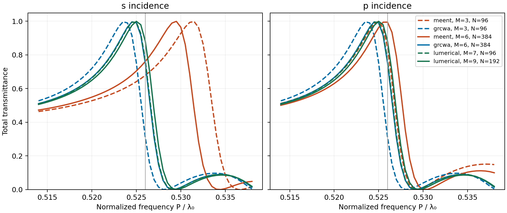

# Periodic RCWA Diagnosis Against Lumerical

[Benchmark report](BENCHMARK_REPORT.md) · [Numerical data](results/benchmark.json) · [Diagnostic script](scripts/diagnose_periodic.py)

Lumerical is the reference for all solver comparisons. Each row below uses the excitation with the largest native Meent–Lumerical complex-amplitude difference in that case's published quick sweep. The native Meent reruns reproduced the saved amplitudes at all twelve points. The study used Meent 0.13.2 and Lumerical v252, build 8.34.4175. The full benchmark reports all solver versions.

## Material-operator and Fourier-order controls

The published quick settings give Lumerical a larger actual Fourier basis. In the installed v252 build, the rectangular solver's `max number ku` and `max number kv` properties act as half-orders. The published $15\times15$ Lumerical basis in class C corresponds to a $7\times7$ basis in the open-source adapters. For class B, Lumerical retains 35 x modes in the published profile and 17 in the matched control. Lumerical returns three y sectors at its minimum y half-order. The y-invariant grating couples only the incident sector. Each matched control checks the native returned order bounds. The runs use the same CAD geometry and requested mesh settings as the original Lumerical run. [Ansys RCWA simulation object](https://optics.ansys.com/hc/en-us/articles/12959229278611-RCWA-Solver-Simulation-Object)

The three Meent runs at each point hold its material raster, Fourier order, eigensolver, and output conversion fixed:

- **Native** uses continuous Fourier coefficients with directional inverse factorization in the transverse material operators.
- **Direct CFS** keeps continuous integration of the same piecewise-constant pixels and uses direct multiplication in both transverse directions. Comparing it with **Native** isolates the effect of the factorization.
- **Direct DFS** uses direct multiplication with centered discrete Fourier coefficients of the same raster. Comparing it with **Direct CFS** measures the separate effect of treating the pixels as midpoint samples.

The transverse matrices, and the associated operator for the longitudinal component, enter the finite Maxwell eigenproblem. Discontinuous interfaces make the matrix representation of a product sensitive to the factorization and Fourier truncation. This sensitivity can change the sampled response substantially near a leaky mode or metallic interface. [Li, *JOSA A* 13, 1870–1876](https://doi.org/10.1364/JOSAA.13.001870)

## Measured differences from Lumerical

The four numerical columns report the maximum absolute difference in a power-normalized complex amplitude. The last three use the same actual Fourier half-order on each patterned axis, $M=8$ for class B and $M=3$ for class C. Values summarize one excitation per case. The [main benchmark](BENCHMARK_REPORT.md) covers the full sweeps.

| Case | Excitation | Native vs published Lumerical | Native vs matched Lumerical | Direct CFS vs matched Lumerical | Direct DFS vs matched Lumerical |
| --- | --- | ---: | ---: | ---: | ---: |
| [B01](#b01) | 620 nm | 0.02181 | 0.03089 | 0.01754 | 0.01724 |
| [B02](#b02) | 1200 nm | 0.07312 | 0.1468 | 0.002231 | 2.24e-13 |
| [B03](#b03) | 920 nm, θ=30°, φ=45° | 0.01767 | 0.02018 | 0.01606 | 0.01610 |
| [B04](#b04) | 620 nm | 0.01878 | 0.02209 | 0.01588 | 0.01597 |
| [B05](#b05) | 1200 nm | 0.02806 | 0.2027 | 0.008124 | 2.48e-14 |
| [B06](#b06) | 633 nm, θ=12° | 0.01955 | 0.02076 | 0.02076 | 0.02077 |
| [C01](#c01) | 1700 nm | 0.1034 | 0.09001 | 0.001217 | 6.90e-15 |
| [C02](#c02) | $P/\lambda_0=0.542$ | 0.9646 | 0.9087 | 0.04010 | 0.03933 |
| [C03](#c03) | 633 nm, radius 110 nm | 0.1268 | 0.2112 | 0.007038 | 0.006648 |
| [C04](#c04) | 633 nm, rotation 45° | 0.3742 | 0.3666 | 0.4304 | 0.4436 |
| [C05](#c05) | 1200 nm, half-period shift | 0.05303 | 0.1088 | 0.01525 | 0.01492 |
| [C06](#c06) | 1550 nm | 1.109 | 1.121 | 0.04289 | 0.04262 |

The strongest improvements already appear with Direct CFS at B02, B05, C01, C02, C03, C05, and C06. That comparison holds continuous pixel integration fixed and isolates the directional factorization. The controls assess agreement with the numerical reference at finite order. Solver convergence requires further refinement.

## Case findings

### B01

The selected discrepancy is concentrated in the zeroth-order p response. At matched order, the continuous material control reduces it from 0.03089 to 0.01754. The residual is comparable to the original gap. A quarter-period rigid translation gives the expected order-dependent phase in all four solvers, with a maximum residual of $1.82\times10^{-13}$ after removing that phase.

### B02

The high-contrast dielectric interface makes the p response sensitive to the transverse material operator. At matched order, replacing directional factorization reduces the amplitude difference from 0.147 to 0.00223 while preserving continuous integration. Using discrete material coefficients brings it to round-off.

### B03

The conical geometry couples s and p channels. The materials control reduces the matched-order residual modestly, from 0.02018 to 0.01606. In an independent one-axis test, both the native Lumerical grid and Fourier settings affect the amplitudes at this excitation.

### B04

The staircase representation of the trapezoid affects the comparison independently of the transverse Fourier treatment. Increasing the number of slices from 8 to 32 changed the Lumerical complex amplitudes by up to 0.00360 at fixed transverse settings. Matching the Meent material operator accounts for part of the residual.

### B05

At 1200 nm, native Meent p transmittance is 0.868 and the published Lumerical value is 0.849. With the actual order aligned, Lumerical gives 0.600. The maximum Meent amplitude difference changes from 0.0281 against the published Lumerical basis to 0.203 against the matched basis. Direct CFS reduces the matched gap to 0.00812. This case shows how finite-order factorization and mismatched truncation can partially cancel in the published comparison. High-contrast metallic interfaces are also known to produce slow TM convergence. [Lalanne and Morris, *JOSA A* 13, 779–784](https://doi.org/10.1364/JOSAA.13.000779)

### B06

Changing the Meent operator has little effect. Across the seven quick angles, the dominant phase difference matches a lateral offset of about half a Lumerical mesh interval. The new fixed-geometry tests from the prior study held the 128 CAD strips fixed and varied the native mesh. The fitted phase slope changed from 1.3245° to 0.3519° per order as the reported mesh went from 136 to 512 x samples. Each slope matches the half-step prediction within 0.001° per order. Removing the fitted ramp in the diagnostic reduces the original maximum amplitude difference to $1.63\times10^{-4}$. [Ansys RCWA index result](https://optics.ansys.com/hc/en-us/articles/12959229278611-RCWA-Solver-Simulation-Object)

### C01

The square hole array requires equal total transmittance for s and p at normal incidence. At 1700 nm, native Meent gives 0.0800 and 0.0146 respectively. The published Lumerical result gives 0.03275 for both inputs. Under identical Fourier order, Direct CFS reduces the amplitude gap from 0.09001 to 0.001217. Direct DFS brings the gap to round-off.

In a separate test of the square cells C01, C02, and C03, the midpoint permittivity raster is unchanged under x–y exchange. If $S$ exchanges the Fourier indices, the transverse blocks should obey $C_x=S C_y S^\mathrm{T}$. The native matrices at quick order have relative maximum-element residuals of 23.8%, 7.27%, and 5.47% at the prior diagnostic points. The native longitudinal blocks satisfy the exchange check to within $2.1\times10^{-15}$. The transverse factorization applies the one-dimensional operations and inversions successively, and the finite truncation and matrix inverse depend on their ordering. The measured loss of exchange symmetry localizes the s–p split to these finite transverse operators for the tested implementation.

### C02

At $P/\lambda_0=0.542$, native Meent gives s and p transmittances of 0.0331 and 0.0355. The published Lumerical transmittance is about 0.995 for both. Aligning the actual order leaves a complex-amplitude gap of 0.909. Direct CFS then reduces it to 0.0401.

The earlier 49-point scan covers the spectral window around $P/\lambda_0=0.526$. Its dominant sampled Lumerical peak moves from 0.5245 to 0.5250 as the actual half-order rises from 7 to 9 and the grid is refined. At quick order, native Meent places its two polarization peaks at 0.5315 and 0.5250. These peak shifts affect fixed-frequency comparisons on the steep sides of the resonance. [Ansys photonic crystal slab example](https://optics.ansys.com/hc/en-us/articles/4416343906067-Photonic-Crystal-Slab-RCWA)



### C03

At 110 nm radius, aligning the Fourier order exposes a native amplitude difference of 0.211. Direct CFS reduces it to 0.00704. The circular pillar has fourfold symmetry and exhibits the transverse-operator exchange issue described in [C01](#c01).

### C04

At 45°, native Meent is closer to matched Lumerical than either direct material operator at the selected settings. Refining the grcwa and Lumerical grid and order together reduces their 45° amplitude gap from 0.444 to 0.0831. The finer residual is only $3.49\times10^{-4}$ at 22.5° and 67.5°. Reversing the CAD angle reverses the cross-polarized amplitude and increases the 45° gap, confirming that the published adapters use the same rotation direction. Rotated-edge sampling remains a significant effect.

### C05

At the half-period layer shift, the matched-order Meent amplitude difference declines from 0.109 to 0.0153 with the continuous direct operator. The relative displacement changes how the diffraction orders from the two layers are coupled. The remaining gap is comparable for the two direct operators.

### C06

The supercell distributes the transmitted field over several propagating orders. At 1550 nm, matching Lumerical's actual Fourier order still leaves a native Meent amplitude gap of 1.12. Direct CFS reduces it to 0.0429, and Direct DFS gives 0.0426. A separate test at 1420 nm also shows strong sensitivity to Fourier order. Comparison of individual orders is important because total transmittance can hide this redistribution.

## Conclusion

Meent's native transverse Fourier factorization explains much of its discrepancy against Lumerical in the high-contrast, resonant, and multi-order cases. The symmetry check identifies a specific limitation of the finite-order implementation for the tested fourfold-symmetric cells. Fourier truncation, geometry sampling, and transverse phase reference account for other discrepancies. The published benchmark retains the native solver settings, and the table above reports the controlled changes at the selected points.

## Reproduce

```powershell
& .\.venv\Scripts\python.exe scripts\diagnose_periodic.py --meent-study
& .\.venv\Scripts\rcwa-cv.exe report --published
```

The first command saves the Meent experiment under `periodic_diagnostics.meent_against_lumerical` in [the numerical dataset](results/benchmark.json). Omit `--meent-study` to rerun the broader periodic controls. Use `--open-only` to compare new Meent runs with the saved Lumerical reference when the license is unavailable.
