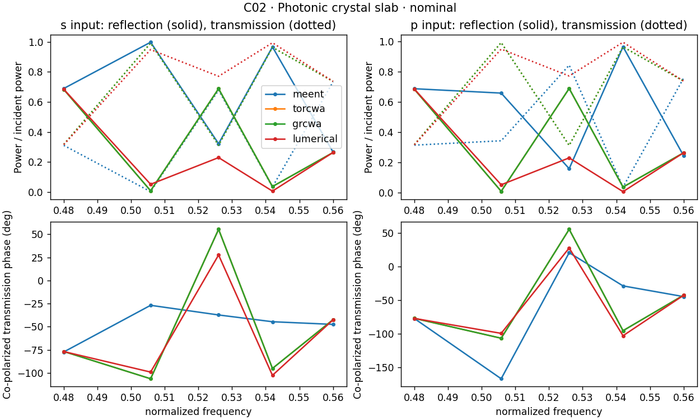

# RCWA Cross-Validation

Compare meent, torcwa on CUDA, grcwa, and Lumerical RCWA on 16 optical benchmarks. Results include reflectance, transmittance, absorptance, diffraction efficiency, and complex power-normalized scattering amplitudes.

## Benchmark results

<!-- BEGIN BENCHMARK -->

Profile **quick**, 91 points across 16 cases. Each point includes s and p incidence.

| Case | Benchmark | Points | Solvers | Max power difference | Max complex-amplitude difference | Status | Details |
| --- | --- | --- | --- | --- | --- | --- | --- |
| [A01](cases/A/A01/A01.ipynb) | Fresnel interface | 14 | 4/4 | 9.63e-14 | 1.59e-13 | PASS | [Table](results/A/A01/comparison.md) |
| [A02](cases/A/A02/A02.ipynb) | Antireflection film | 5 | 4/4 | 1.52e-14 | 8.49e-15 | PASS | [Table](results/A/A02/comparison.md) |
| [A03](cases/A/A03/A03.ipynb) | DBR mirror | 5 | 4/4 | 2.55e-13 | 1.38e-13 | PASS | [Table](results/A/A03/comparison.md) |
| [A04](cases/A/A04/A04.ipynb) | Absorbing metal film | 3 | 4/4 | 1.78e-15 | 5.25e-15 | PASS | [Table](results/A/A04/comparison.md) |
| [B01](cases/B/B01/B01.ipynb) | Binary dielectric grating | 4 | 4/4 | 0.00818 | 0.0263 | INCONCLUSIVE | [Table](results/B/B01/comparison.md) |
| [B02](cases/B/B02/B02.ipynb) | High-contrast grating | 5 | 4/4 | 0.116 | 0.147 | INCONCLUSIVE | [Table](results/B/B02/comparison.md) |
| [B03](cases/B/B03/B03.ipynb) | Conical incidence | 5 | 4/4 | 0.00628 | 0.0177 | INCONCLUSIVE | [Table](results/B/B03/comparison.md) |
| [B04](cases/B/B04/B04.ipynb) | Trapezoidal grating | 4 | 4/4 | 0.00579 | 0.0188 | INCONCLUSIVE | [Table](results/B/B04/comparison.md) |
| [B05](cases/B/B05/B05.ipynb) | Wire-grid polarizer | 3 | 4/4 | 0.268 | 0.203 | INCONCLUSIVE | [Table](results/B/B05/comparison.md) |
| [B06](cases/B/B06/B06.ipynb) | Volume index grating | 7 | 4/4 | 0.00017 | 0.0196 | INCONCLUSIVE | [Table](results/B/B06/comparison.md) |
| [C01](cases/C/C01/C01.ipynb) | Metal nanohole array | 5 | 4/4 | 0.141 | 0.117 | INCONCLUSIVE | [Table](results/C/C01/comparison.md) |
| [C02](cases/C/C02/C02.ipynb) | Photonic crystal slab | 5 | 4/4 | 0.991 | 1.02 | INCONCLUSIVE | [Table](results/C/C02/comparison.md) |
| [C03](cases/C/C03/C03.ipynb) | Cylindrical meta-atom | 5 | 4/4 | 0.0188 | 0.266 | INCONCLUSIVE | [Table](results/C/C03/comparison.md) |
| [C04](cases/C/C04/C04.ipynb) | Rotated nanofin | 5 | 4/4 | 0.148 | 0.468 | INCONCLUSIVE | [Table](results/C/C04/comparison.md) |
| [C05](cases/C/C05/C05.ipynb) | Shifted bilayer | 12 | 4/4 | 0.0208 | 0.123 | INCONCLUSIVE | [Table](results/C/C05/comparison.md) |
| [C06](cases/C/C06/C06.ipynb) | Metagrating supercell | 4 | 4/4 | 0.664 | 1.21 | INCONCLUSIVE | [Table](results/C/C06/comparison.md) |

The maximum power difference includes total R, T, A and propagating-order efficiency. Nonconverged periodic results are marked INCONCLUSIVE.

### Software versions for this benchmark

| Software or runtime | Version or device |
| --- | --- |
| Python | 3.11.8 |
| rcwa-cross-validation | 0.2.0 |
| numpy | 2.4.6 |
| scipy | 1.17.1 |
| matplotlib | 3.10.8 |
| PyYAML | 6.0.3 |
| threadpoolctl | 3.8.0 |
| meent | 0.13.2 |
| grcwa | 0.1.2 |
| torcwa | 0.1.4.2 |
| torch | 2.8.0+cu128 |
| jupyterlab | 4.6.6 |
| ipykernel | 7.4.0 |
| Lumerical RCWA | v252 / build 8.34.4175 |
| PyTorch CUDA runtime | 12.8 |
| torcwa device | NVIDIA GeForce RTX 4060 Laptop GPU |
| Operating system | Windows-10-10.0.22621-SP0 |

<!-- END BENCHMARK -->

## Run the benchmark

On Windows, install [uv](https://docs.astral.sh/uv/), use a compatible NVIDIA driver, and install and license Ansys Lumerical FDTD. Run these commands from the repository root.

```powershell
& .\scripts\setup_windows.ps1
& .\.venv\Scripts\rcwa-cv.exe benchmark
```

The benchmark command runs all 16 quick sweeps, saves the detailed reports under `results/`, and refreshes the README tables and the figures inside each case folder. An incomplete solver run leaves the published README snapshot unchanged and returns a nonzero exit code. For a full refinement sweep, use `rcwa-cv benchmark --profile convergence`.

The setup script selects Python 3.11 and CUDA PyTorch 2.8.0 with CUDA 12.8. meent and grcwa run on CPU. torcwa uses double precision on the GPU. The Lumerical adapter locates a standard installation. For a custom location, copy `configs/local.example.yaml` to `configs/local.yaml` and set `lumapi_path`.

You can install the CPU solvers and notebooks alone with `uv pip install -e '.[notebook,dev]'` in an active virtual environment. Individual notebook cells let you choose which solver to run.

## Explore a case

Open [the case catalog](cases/README.md) or select a case from the benchmark table. Each case folder contains a Jupyter notebook with separate solver cells, a shared `case.yaml`, a native Lumerical `model.fsp`, a reproducible `model.lsf`, and preview figures.

```powershell
& .\.venv\Scripts\jupyter-lab.exe
& .\.venv\Scripts\rcwa-cv.exe run B/B01
& .\.venv\Scripts\rcwa-cv.exe converge C/C02 --profile pilot --representative
& .\.venv\Scripts\rcwa-cv.exe report --run <run_id>
& .\.venv\Scripts\python.exe -m pytest -q
```

The notebooks run the same solver adapters as the command line. Their code cells rerun the quick sweep and draw fresh plots. The saved preview images and [case results](results/README.md) are available directly on GitHub. See [comparison conventions](docs/conventions.md) for the definitions of orders, amplitudes, tolerances, and convergence.

After editing a case definition, regenerate its notebook and Lumerical model with `& .\.venv\Scripts\python.exe scripts/build_case_assets.py A/A01`.

The [C02 case page](cases/C/C02/README.md) shows a photonic crystal slab and its transmission spectrum.



## Use Lumerical directly

Open `model.fsp` in Lumerical FDTD to inspect and run the supplied geometry. Each model represents point 0 of its case's quick sweep. The `model.lsf` script reconstructs that point and exports its optical results as `rcwa_output.mat`. Run it in a **new unsaved FDTD document** because it clears the current layout.

To export a different sweep point or add a manually computed point to a saved comparison, use its zero-based index.

```powershell
& .\.venv\Scripts\rcwa-cv.exe export-lumerical C/C02 --point 2
& .\.venv\Scripts\rcwa-cv.exe import-lumerical --run <run_id> --point 2 --mat <path-to-rcwa_output.mat>
```
