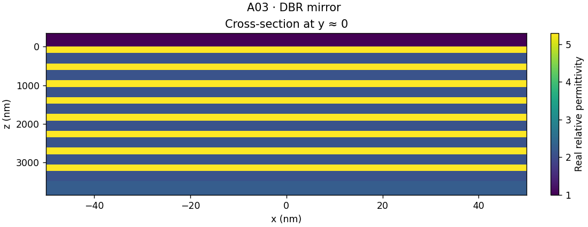
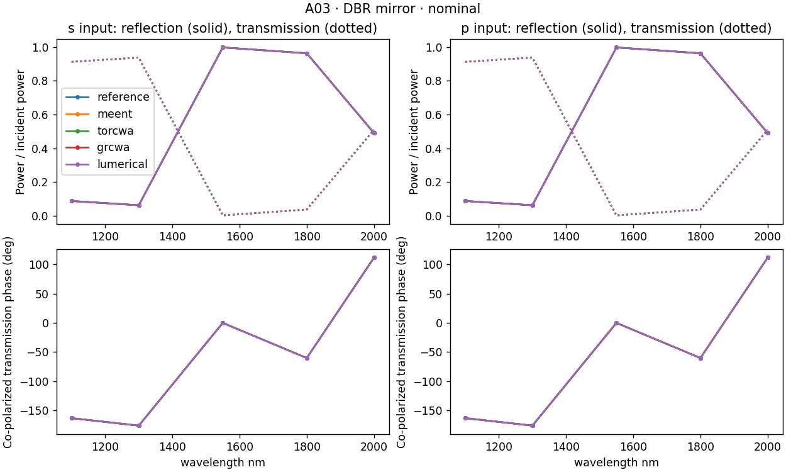
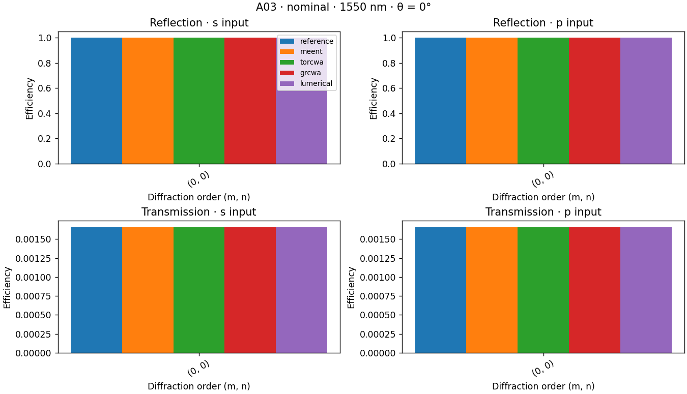
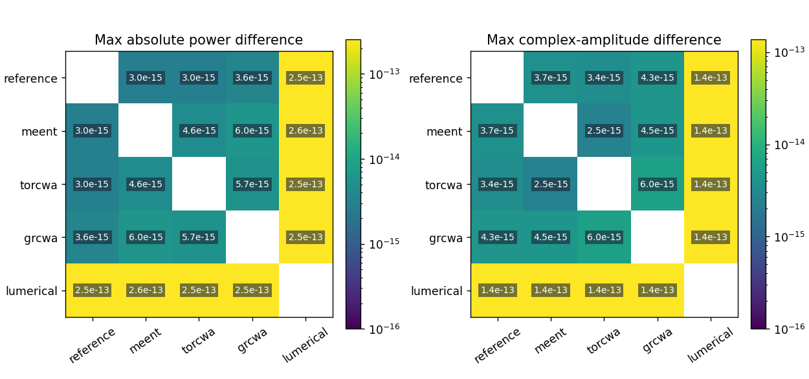

# A03 — DBR mirror

Check layer order, stopband and phase for eight quarter-wave dielectric pairs at a design wavelength of 1550 nm.

The geometry and scan points are defined in [case.yaml](case.yaml). Lengths and vacuum wavelengths use nanometers, and angles use degrees.

```powershell
rcwa-cv run A/A03 --profile quick
rcwa-cv converge A/A03
```

See the [category consistency table](../../../results/A/consistency.md).

## Notebook and Lumerical model

- [Open the Jupyter notebook](A03.ipynb) to run each solver and generate the plots.
- Open [model.fsp](model.fsp) in Lumerical FDTD to inspect quick-sweep point 0.
- Run [model.lsf](model.lsf) in a new unsaved FDTD document to reconstruct that point and export the native results.

## Benchmark figures









See the [pairwise table](../../../results/A/A03/comparison.md) for numerical differences and [sweep coordinates](../../../results/A/A03/points.csv).
