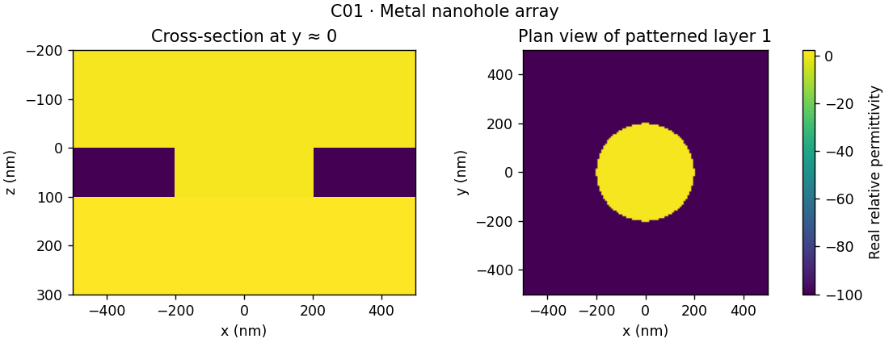
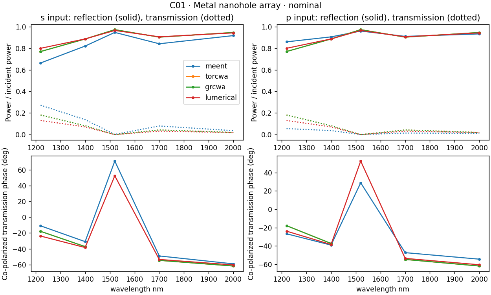
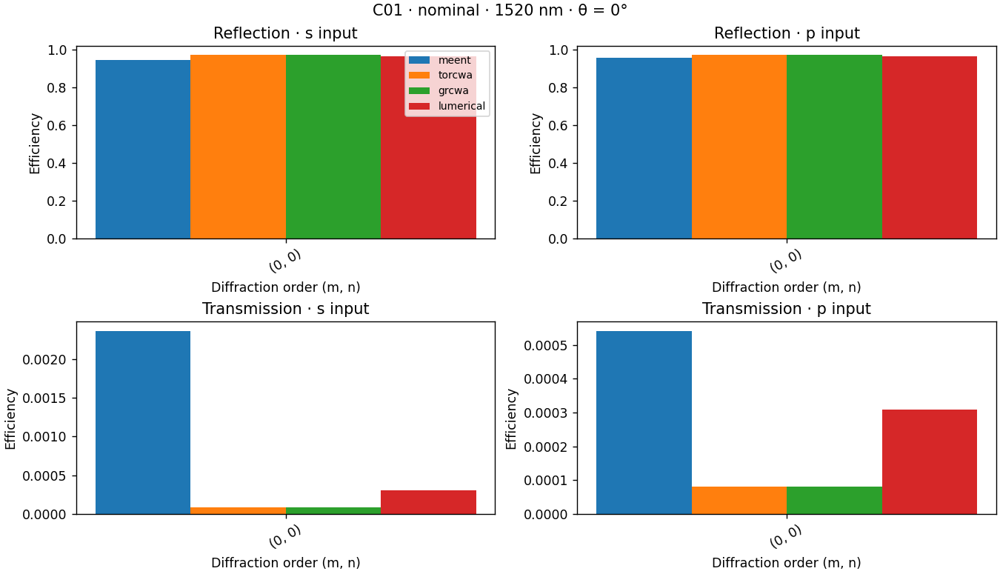
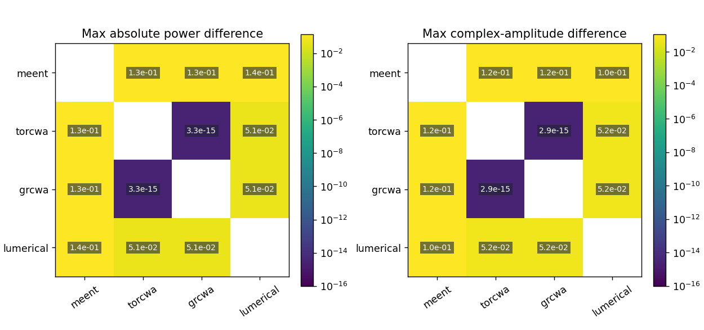

# C01 — Metal nanohole array

Compare the spectrum, absorption and diffraction of a periodic perforated metal film.

The geometry and scan points are defined in [case.yaml](case.yaml). Lengths and vacuum wavelengths use nanometers, and angles use degrees.

```powershell
rcwa-cv run C/C01 --profile quick
rcwa-cv converge C/C01
```

See the [category consistency table](../../../results/C/consistency.md).

## Notebook and Lumerical model

- [Open the Jupyter notebook](C01.ipynb) to run each solver and generate the plots.
- Open [model.fsp](model.fsp) in Lumerical FDTD to inspect quick-sweep point 0.
- Run [model.lsf](model.lsf) in a new unsaved FDTD document to reconstruct that point and export the native results.

## Benchmark figures









See the [pairwise table](../../../results/C/C01/comparison.md) for numerical differences and [sweep coordinates](../../../results/C/C01/points.csv).
