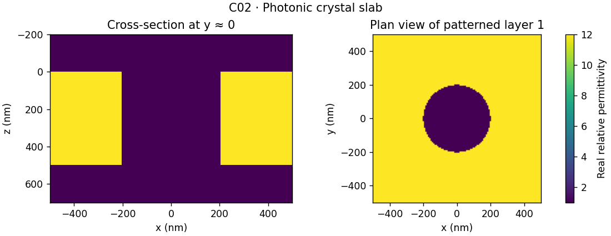
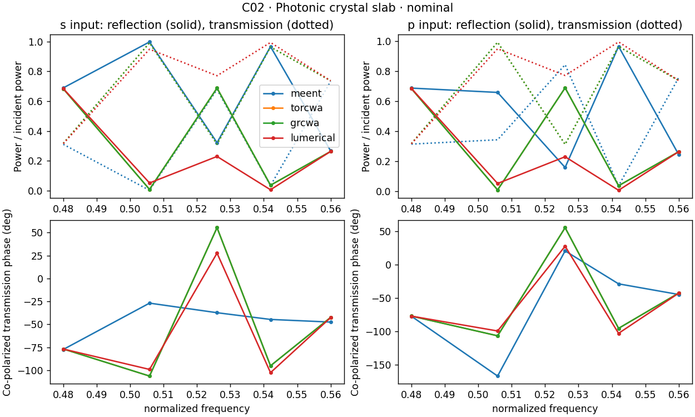
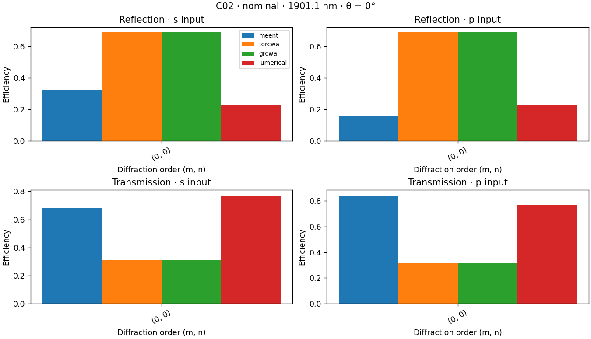
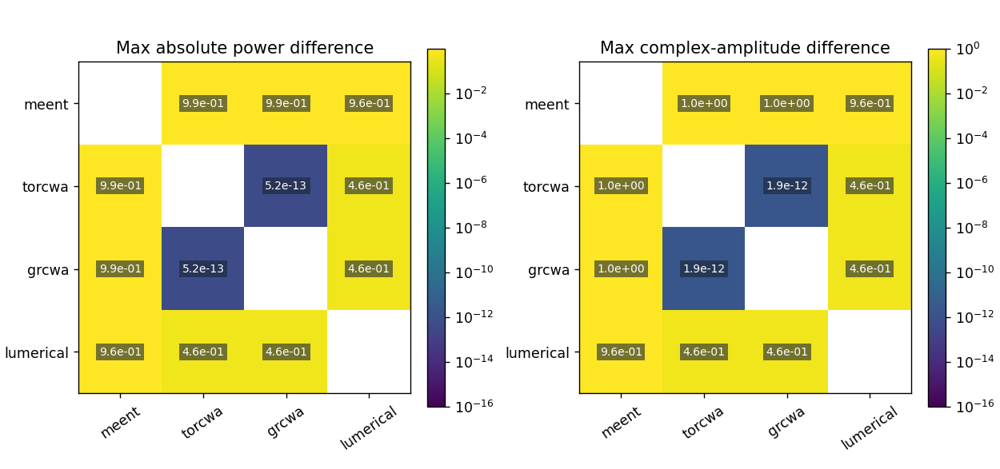

# C02 — Photonic crystal slab

Reproduce the guided-resonance spectrum from the [S4 paper](https://web.stanford.edu/group/fan/publication/Liu_ComputerPhysicsCommunications_183_2233_2012.pdf) and the [Ansys example](https://optics.ansys.com/hc/en-us/articles/4416343906067-Photonic-Crystal-Slab-RCWA). Compare the transmission peaks near normalized frequencies 0.5058, 0.5260 and 0.5420.

The geometry and scan points are defined in [case.yaml](case.yaml). Lengths and vacuum wavelengths use nanometers, and angles use degrees.

```powershell
rcwa-cv run C/C02 --profile quick
rcwa-cv converge C/C02
```

See the [category consistency table](../../../results/C/consistency.md).

## Notebook and Lumerical model

- [Open the Jupyter notebook](C02.ipynb) to run each solver and generate the plots.
- Open [model.fsp](model.fsp) in Lumerical FDTD to inspect quick-sweep point 0.
- Run [model.lsf](model.lsf) in a new unsaved FDTD document to reconstruct that point and export the native results.

## Benchmark figures









See the [pairwise table](../../../results/C/C02/comparison.md) for numerical differences and [sweep coordinates](../../../results/C/C02/points.csv).
