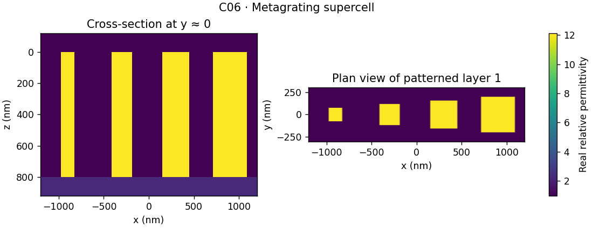
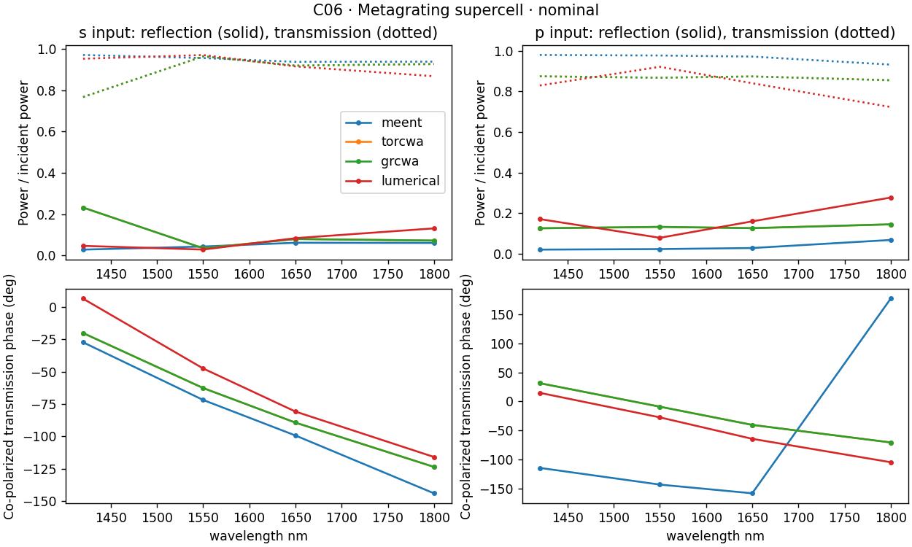
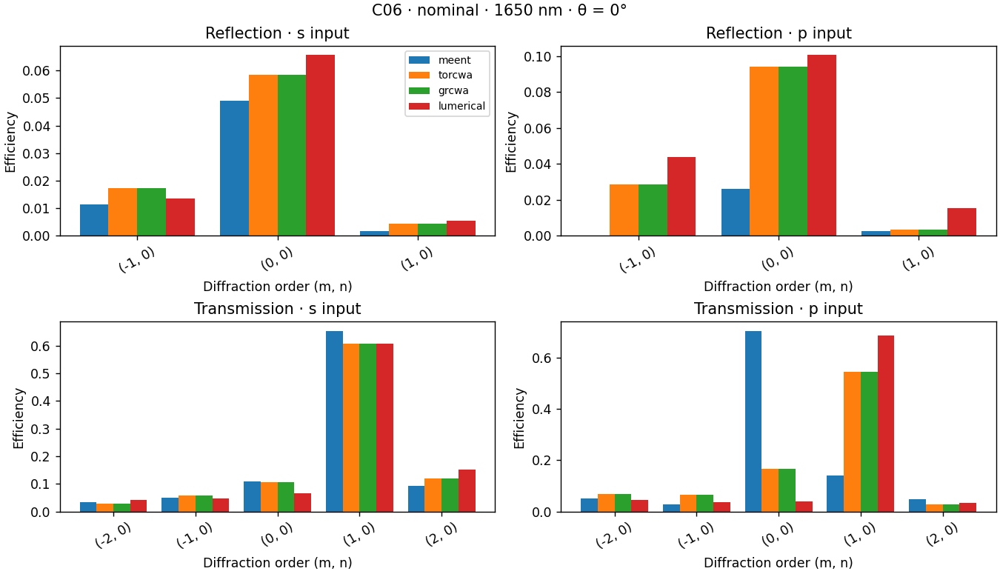
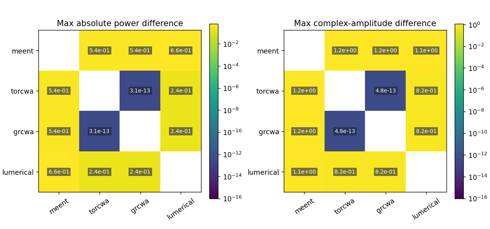

# C06 — Metagrating supercell

Compare power in the target (+1, 0) transmitted order and other orders of a four-pillar beam-steering supercell.

The geometry and scan points are defined in [case.yaml](case.yaml). Lengths and vacuum wavelengths use nanometers, and angles use degrees.

The upper scan point is 1799.9 nm, just below the transmitted second-order Rayleigh cutoff at 1800 nm.

```powershell
rcwa-cv run C/C06 --profile quick
rcwa-cv converge C/C06
```

See the [category consistency table](../../../results/C/consistency.md).

## Notebook and Lumerical model

- [Open the Jupyter notebook](C06.ipynb) to run each solver and generate the plots.
- Open [model.fsp](model.fsp) in Lumerical FDTD to inspect quick-sweep point 0.
- Run [model.lsf](model.lsf) in a new unsaved FDTD document to reconstruct that point and export the native results.

## Benchmark figures









See the [pairwise table](../../../results/C/C06/comparison.md) for numerical differences and [sweep coordinates](../../../results/C/C06/points.csv).
